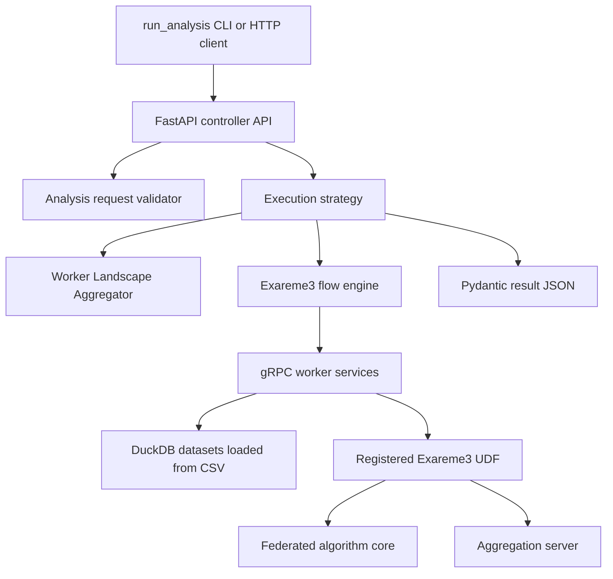

# Architecture

## Detected App Type

Exaflow is a Python backend/service repository with a monorepo-like nested
package. The root package runs a federated execution engine with controller,
worker, aggregation server, algorithm, testing, deployment, and documentation
subsystems. `exadata-validator` is a separate Python package for validating
data-model folders.

No frontend application was detected in this repository.

## High-Level Structure

## Request and Data Flow

1. Clients discover common source inputdata, preprocessing, and algorithm
   specifications through `GET /specifications/inputdata`,
   `GET /specifications/preprocessing`, and `GET /specifications/algorithms`.
   Metadata remains available through routes such as `/datasets`,
   `/datasets_variables`, and `/cdes_metadata`.
1. Clients submit `POST /analysis` with an `AnalysisRequestDTO` payload. The
   selected algorithm name is carried in `algorithm.name`.
1. FastAPI validates the body against `AnalysisRequestDTO` in
   `exaflow/controller/http/endpoints.py`. A body that does not match is
   answered with `422`. `analysis_service.run_analysis` then delegates to
   `validate_analysis_request`.
1. `get_algorithm_execution_strategy` selects a native Exareme3 strategy.
1. Exareme3 strategy gets worker metadata, applies preprocessing metadata
   transforms, constructs `Exareme3AlgorithmFlowEngineInterface`, and runs the
   algorithm wrapper.
1. Algorithm wrappers under `exaflow/algorithms/exareme3` dispatch registered
   UDF calls to workers.
1. Workers load Arrow/Pandas data from DuckDB, apply worker-side preprocessing,
   enforce minimum-row privacy checks, and execute registered UDFs.
1. Optional aggregation-server-aware UDFs push partial values to the gRPC
   aggregation server and read combined results.
1. The algorithm returns a Pydantic model, serialized by the strategy as JSON.

## Module Boundaries

- Controller HTTP routing should stay in `exaflow/controller/http`.
- Controller DTOs and request/spec validation should stay in
  `exaflow/controller/services/api`.
- Worker landscape aggregation and task orchestration should stay in
  `exaflow/controller/services`.
- Worker data loading, UDF execution, and DuckDB handling should stay in
  `exaflow/worker`.
- Runtime algorithm wrappers, preprocessing specs, and UDF registration should
  stay in domain folders under `exaflow/algorithms/exareme3`. Related reports and
  steps live together; CV variants stay beside their models. Base classes and
  recursive discovery determine runtime roles independently of folder names.
  See the [runtime author guide](../../exaflow/algorithms/exareme3/README.md#domain-layout)
  for the complete preprocessing module index.
- Algorithm math belongs to the statistical library; its [local guide](../../exaflow/algorithms/federated/AGENTS.md)
  owns the domain layout and library interfaces.
- Deployment manifests should stay in `kubernetes` and Dockerfiles.
- Data-model folder validation should stay inside `exadata-validator`.

## Dependency Direction

The normal dependency direction is:

`controller API -> controller services -> worker clients -> worker gRPC service -> worker UDF service -> algorithm wrappers/core`.

The statistical library has its own [development guide](../../exaflow/algorithms/federated/AGENTS.md).
Runtime adapters supply application configuration, interpret library results,
and apply application error policies.

The shared translator in `exareme3/utils/error_translation.py` explicitly maps
each reason to an exception class and replacement text or `KEEP_MESSAGE`.
Worker UDF execution and the controller strategy catch only `FedError` for
translation and retain it as the cause. The reason determines whether the
application raises actionable `BadUserInput`, recognized computational
`AnalysisExecutionError`, a native internal exception, or `InsufficientDataError`.
The latter preserves worker skipping for the Outlier Report threshold check.
Runtime privacy checks remain outside the library. Worker gRPC `INTERNAL`
responses become generic controller `RuntimeError` failures, rather than worker
connection errors. `AnalysisExecutionError` crosses worker gRPC as `ABORTED` and
reaches clients as HTTP 462 or the matching RabbitMQ error code. Unexpected
dependency exceptions retain their library types;
there is no blanket wrapping or Pydantic unwrapping.

## Persistence Layer

Workers load CSV datasets into DuckDB. Worker config resolves `data_path` and
DuckDB path through `exaflow/worker/__init__.py`, using
`EXAFLOW_WORKER_CONFIG_FILE` when set or bundled `config.toml` otherwise.

There is no traditional migration framework detected. Data fixtures live under
`tests/test_data`; prod validation data paths are generated by
`tests/worker_data_paths_builder.py`.

## API Layer

The FastAPI controller exposes:

- `GET /specifications/inputdata`
- `GET /specifications/preprocessing`
- `GET /specifications/algorithms`
- `POST /analysis`
- `GET /datasets`
- `GET /datasets_locations`
- `GET /datasets_variables`
- `GET /cdes_metadata`
- `GET /data_models_attributes`
- `POST /wla`
- `GET /healthcheck` (checks every worker; readiness probe only)
- `GET /livez` (controller process only; startup and liveness probes)
- Legacy Flower routes and worker RPCs have been removed.

`documentation/api-specification.md` is the human-facing API contract. The
runtime source of truth for algorithm form shape remains the specification
endpoints.

## Background Jobs and Services

Controller startup calls `start_background_services()`, which maintains runtime
state such as worker landscape aggregation, and `start_analysis_execution()`,
which creates the analysis thread pool. Shutdown stops that pool.

Analyses run on one `ThreadPoolExecutor` sized by `max_concurrent_experiments`
(Helm value, passed as `MAX_CONCURRENT_EXPERIMENTS`, default 32). A semaphore
of the same size rejects further `POST /analysis` requests with HTTP 503
instead of queueing them. `/livez`, `/healthcheck`, and `/wla` do not use that
pool. Aggregation configuration and cleanup also run on it. If the client
disconnects, the request waits until the analysis thread finishes before
aggregation cleanup.

Concurrent analyses need matching capacity downstream. A `RunUdf` call holds a
worker gRPC thread, and an `Aggregate` call holds an aggregation server thread,
while it waits for the other workers. Both pools are therefore derived from
`max_concurrent_experiments`: workers get `max_concurrent_experiments + 4`
gRPC threads and the aggregation server gets `max_concurrent_experiments`
threads per worker, in Helm and in `inv create-configs`. Smaller pools
let partial steps of different analyses hold every thread until the
aggregation wait times out.

Kubernetes probes: startup and liveness both call `/livez` with a 5 second
timeout (liveness `failureThreshold` 3). Readiness calls `/healthcheck`, which
can take as long as `worker_tasks_timeout`. A worker that is down does not
restart the controller. Uvicorn closes the listen socket at SIGTERM, so
`/livez` fails during the drain. Kubelet stops the liveness and startup probes
of a terminating pod (`SyncTerminatingPod` calls `StopLivenessAndStartup`, then
`killPod`), so that failure does not restart the pod. The liveness probe does
not set its own grace period.

Shutdown: a `preStop` sleep (5 s) keeps the pod serving until Endpoints stop
routing to it. After SIGTERM Uvicorn drains in-flight requests for
`graceful_timeout` (120 s), cancels the request tasks still running, and starts
the lifespan hook without waiting for them. A cancelled request still waits for
its analysis thread (`run_blocking`), so the lifespan hook
(`endpoints.shutdown`) calls `begin_controller_shutdown()`: it cancels the
registered `RunUdf` and aggregation `Configure` RPCs, and any registered after
it. Worker-landscape metadata RPCs are cancelled too, because their executor
threads would otherwise keep the process alive for `worker_tasks_timeout`.
Cleanup and the metadata calls that release resources are not cancelled. The
hook stops the worker-landscape thread (join bounded by
`shutdown_cleanup_timeout`, 10 s), then allows admitted analyses up to 15 s
before closing the analysis pool. This combines `shutdown_rpc_cancel_timeout`
(5 s) for RPC cancellation and analysis teardown with `shutdown_cleanup_timeout`
(10 s) for aggregation cleanup. The final thread join is bounded by
`shutdown_rpc_cancel_timeout` (5 s). These waits fit within the 60 s lifespan
shutdown budget. A
client disconnect during the drain cancels nothing. The pod grace period is
the sum of the preStop sleep (5 s), `graceful_timeout` (120 s), the RPC cancel
(5 s), the cleanup (10 s), `shutdown_timeout` (60 s) and a 20 s margin, which is
220 s at the chart defaults. It does not include `worker_tasks_timeout`. The
numbers live in `exaflow/controller/services/controller_shutdown.py`. The
same-named Helm keys only size the grace period, and a test fails when they
differ.

Workers expose gRPC services and load data at startup. The aggregation server
keeps request-scoped aggregation contexts until cleanup. Cleanup removes a
context only when the caller's ownership token matches the token stored when
that caller configured it.

## External Services

- Worker gRPC services.
- Aggregation server gRPC service.
- Docker, Helm, and Kubernetes/kind for deployment and prod validation tests.
- CI publishing uses external registries and secrets.

## Config and Environment Model

- Controller reads `EXAFLOW_CONTROLLER_CONFIG_FILE` or bundled
  `exaflow/controller/config.toml`.
- Worker reads `EXAFLOW_WORKER_CONFIG_FILE` or bundled
  `exaflow/worker/config.toml`.
- Aggregation server reads `AGG_SERVER_CONFIG_FILE` or bundled
  `exaflow/aggregation_server/config.toml`.
- `EXAREME3_ALGORITHM_FOLDERS` controls algorithm discovery.
- Local deployment uses `.deployment.toml` and generated files under `configs/`.
- `GRPC_MAX_MESSAGE_MB` (default 100) is the send and receive limit, in
  mebibytes, for every controller-worker and aggregation gRPC message.
  Helm value `grpc_max_message_mb` passes it to the controller, workers, and
  aggregation server through their config files; `exaflow/grpc_options.py`
  turns each component's configured value into gRPC options.

## Known Gaps

- Static typecheck command is unknown.
- Full production deployment expectations outside the documented Helm/kind flows
  need verification.

## Optional RabbitMQ analysis transport

FastAPI lifespan can own a bounded async AMQP consumer alongside HTTP. Both call
`analysis_service.run_analysis`; HTTP rejects excess analyses while AMQP waits
for the same capacity and validates after admission. Metadata and health requests
remain independent of analysis slots. The periodic worker landscape refresher runs in its background thread. The
periodic refresher and `POST /wla` share a single in-flight refresh. HTTP callers
await its result without using an executor thread per caller.

A queue backlog can make HTTP analysis submissions return 503 until queued
waiters are admitted. Each delivery passively checks its reply destination and
publishes through its own channel on a dedicated publisher connection, so a
broker memory alarm cannot block request acknowledgements. A rejected reply
dead-letters only that request. Transient publication retries reuse the result;
completed replies for unsettled deliveries have bounded in-memory retention for
same-controller redelivery.

Controller and worker request logging uses fixed service loggers with per-record
request IDs, rather than permanently registering a logger and handler for every
logical request. Worker request adapters retain their ContextVar isolation.

Logical `request_id` values survive retries; UUID `context_id` values identify
attempts and key all aggregation state. Both are carried to aggregation services
and logged. This changes internal RPC contracts and requires coordinated rollout.
See `documentation/rabbitmq-analysis.md` for delivery, lifecycle, configuration,
and rollback behavior.
