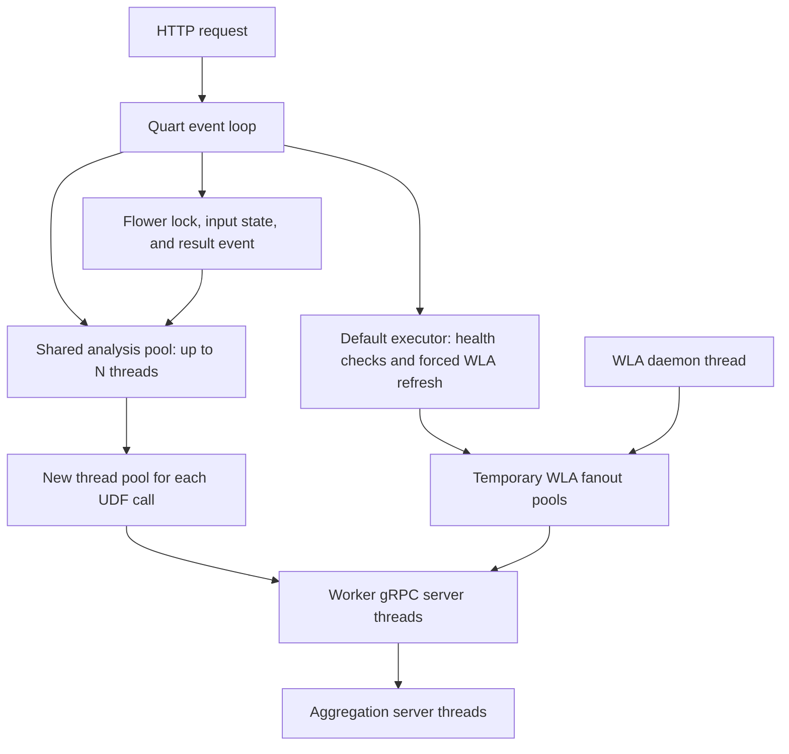
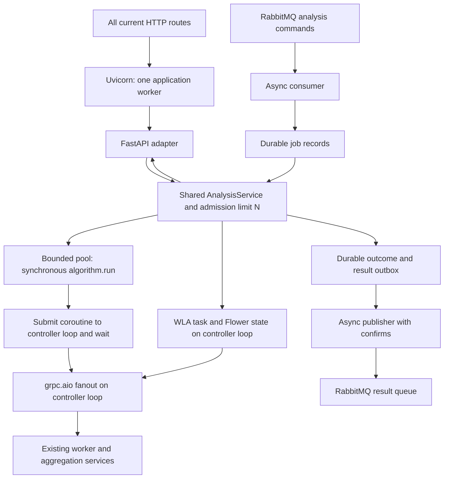

# Controller modernization plan

Status: Proposed; implementation has not started. Updated: 2026-11-01.

## Intended outcome

Use FastAPI with Uvicorn replacing Hypercorn, RabbitMQ for asynchronous
analysis submission, and one shared analysis service for both transports.
Preserve all current HTTP routes, including the synchronous result returned
by `POST /analysis`. Keep existing synchronous algorithm implementations and
the worker and aggregation server protocols.

Implement this through separate changes: first establish contracts and runtime
ownership, then simplify controller I/O, replace the HTTP adapter, replace the
ASGI server, and finally add durable messaging. Migrate Quart to FastAPI before
switching Hypercorn to Uvicorn so each change can be validated independently.
A framework or server replacement alone will not simplify worker RPCs or make
algorithms faster. Measure performance before claiming a gain.

## Current and proposed execution

The current controller has several independent sources of threads:



`N` is `max_concurrent_experiments`, currently defaulting to 32. Worker UDFs
and aggregation run in separate service processes. Flower launches additional
processes on workers. Its result wait is an asyncio event in the controller.

The target keeps a bounded pool for algorithm code while moving controller
network I/O and background coordination onto one event loop:



FastAPI, RabbitMQ callbacks, WLA scheduling, Flower events, and async gRPC
clients belong to the same controller loop. Job storage uses a separate,
single-thread executor for blocking SQLite operations. Keep a small helper
executor only where blocking work remains unavoidable. Remove the per-UDF
and WLA fanout pools and the WLA daemon thread. Libraries may still create
internal threads; this is not a promise of a thread-free controller.

## HTTP scope

| Method | Route | RabbitMQ equivalent in this plan |
| --- | --- | --- |
| GET | `/datasets` | None |
| GET | `/datasets_locations` | None |
| GET | `/datasets_variables` | None |
| GET | `/cdes_metadata` | None |
| GET | `/data_models_attributes` | None |
| GET | `/specifications/inputdata` | None |
| GET | `/specifications/preprocessing` | None |
| GET | `/specifications/algorithms` | None |
| POST | `/wla` | None |
| GET | `/healthcheck` | None |
| GET | `/livez` | None |
| POST | `/analysis` | `analysis.execute` |
| GET | `/flower/input` | None; remains a Flower callback route |
| POST | `/flower/result` | None; remains a Flower callback route |

Preserve analysis request and result shapes, response serialization, existing
HTTP error mappings, and the privacy-safe insufficient-data message. Capture
content types and malformed-request behavior before migration: FastAPI's
default validation and JSON serialization can change these unintentionally.
Do not replace the HTTP analysis response with `202 Accepted` or require
RabbitMQ for HTTP execution.

Flower callback correlation is one explicit proposed contract change: require
an execution identifier on the existing callback routes and update bundled
Flower clients in the same release. This prevents a late result from an old
attempt completing a newer analysis. Document the required header and upgrade
any external Flower callback producers before deployment.

## Runtime invariants

- Use one controller process per federation and one Uvicorn application worker.
  In-memory state and locks are process-local; multiple web workers would not
  share them. Flower concurrency remains one.
- Both transports use the same DTO/spec validation, WLA snapshot, strategy
  selection, execution limit, cleanup, and outcome mapping. Adapters never
  call each other through HTTP.
- HTTP admission remains immediate: return 503 when capacity is unavailable.
  RabbitMQ uses bounded prefetch and waits asynchronously for capacity; do not
  repeatedly reject and requeue messages just because the controller is busy.
  Waiting deliveries must not be bypassed indefinitely by new HTTP arrivals.
- RPC completion, Flower callbacks, probes, and cleanup must not require a
  free analysis-pool thread. The event loop must never wait synchronously for
  a result submitted to itself.
- Dispatch every participant in an aggregation round. Preserve downstream
  capacity: workers currently have `N + 4` gRPC threads and the aggregation
  server has `N` threads per local worker. A smaller arbitrary RPC concurrency
  limit can strand partial rounds even with async controller clients.
- A cancelled HTTP waiter or closed RabbitMQ channel does not own the lifetime
  of an analysis. Track execution independently until its thread, RPCs, and
  cleanup settle; release its slot only then.
- Retain current per-call worker timeouts. Do not add an early overall HTTP
  timeout that releases capacity while a Python thread is still running.
  Python threads and remote handlers cannot be forcibly stopped by cancelling
  their asyncio waiters.

## Implementation stages

### 0. Establish behavior and performance baselines

Record all routes, success/error bodies, content types, request limits, and
validation behavior from
[the current endpoints](../../exaflow/controller/quart/endpoints.py) and
[error handlers](../../exaflow/controller/quart/error_handlers.py). Add focused
contract coverage where behavior is not already tested.

Measure the same representative analyses at concurrency 1, 8, N, and above N:
completion time, throughput, p50/p95 latency, `/livez` latency, event-loop lag,
RSS, and controller thread count. Include an aggregation-backed algorithm,
large results, slow/unavailable workers, and Flower when enabled. Separate
admission delay from execution time. Verify dependency choices support the
repository's Python constraint before selecting versions.

Gate: repeatable baseline and recorded HTTP contract; no runtime migration yet.

### 1. Extract a shared runtime while retaining Quart

Introduce an application-owned `ControllerRuntime` and `AnalysisService`
under `exaflow/controller/services`. The runtime owns executors, admission,
active executions, WLA, Flower state, clients, and supervised background tasks.
Initialize it at application startup instead of introducing new module-global
mutable state.

Move orchestration out of the route into the service: validated DTO, pinned
WLA snapshot, strategy, execution, and typed success/failure. Keep transport
status codes and response formatting in adapters. Use one metadata snapshot
for validation, worker selection, and execution preparation; snapshot contents
must not be mutated after publication.

Refactor `analysis_execution.py`, `startup.py`, the strategy factory, and
strategy injection without changing algorithm mathematics. Make execution
ownership resilient to disconnects and repeated cancellation. Track every
started thread and cleanup operation through shutdown.

Gate: existing HTTP/concurrency/cancellation tests pass; both runtime creation
and teardown work repeatedly without leaked background tasks or globals.

### 2. Replace controller RPC thread fanout with async gRPC

Introduce runtime-owned `grpc.aio` channels and stubs for controller-to-worker
and controller-to-aggregation calls. Following the
[gRPC ownership rules](https://grpc.github.io/grpc/python/grpc_asyncio.html),
create, use, and close them on their owning loop. Reuse channels; retire
endpoints without closing calls still in flight. Preserve message limits,
timeout configuration, and error mappings. Keep worker-side synchronous
aggregation clients intact.

Keep `algorithm.run()` and `engine.run_udf()` synchronous. From an analysis
thread, use a narrow bridge based on
`asyncio.run_coroutine_threadsafe()` to submit async worker fanout to the loop.
Only that analysis thread waits for the result. Reject bridge calls made from
the loop thread. Remove the per-call `ThreadPoolExecutor` from
`algorithm_flow_engine_interface.py`.

Preserve worker ordering and insufficient-data handling. On a fatal fanout
failure, cancel sibling client calls and abort aggregation before waiting for
participants that may need that abort to exit. Account for every task; merely
using `asyncio.gather()` is not a complete cancellation policy. Apply finite
deadlines to configure/cleanup RPCs and handle an uncertain configure outcome
without leaking a context or cleaning another execution's context.

Avoid synchronous DNS calls during client creation. Keep substantial CPU work
and result conversion off the event loop where needed. Workers, aggregation
servers, generated protobufs, and algorithm implementations remain unchanged.

Gate: real gRPC integration tests cover concurrent rounds, partial failures,
timeouts, message limits, cancellation, and cleanup with all N threads busy.
No per-UDF controller pool remains; existing result tests still pass.

### 3. Move WLA and Flower coordination onto the runtime loop

Replace the WLA daemon/sleep loop with a supervised periodic asyncio task and
an async refresh lock. Periodic refresh and `POST /wla` share that lock. Fetch
worker metadata concurrently through async clients and atomically publish a
complete replacement snapshot. Keep the last successful snapshot on refresh
failure and expose/log refresh status. Worker health checks use async RPCs
independently of analysis capacity.

Keep Flower input/result state and its single-execution lock on the loop.
Use async worker RPCs for process launch, stop, and garbage collection. Admit
Flower work without letting requests waiting for its lock occupy all global
analysis slots. Track launch outcomes so cancellation cannot orphan an
acknowledged process. Add attempt correlation to input/result callbacks and
update `exaflow/algorithms/flower/inputdata_preprocessing.py` with the required
identifier and finite callback timeouts. Test delayed callbacks explicitly.

Gate: refresh failure preserves usable metadata; shutdown stops the periodic
task promptly; native analyses, probes, and Flower callbacks progress under
load. Flower inputs/results cannot cross between executions.

### 4. Replace the Quart HTTP adapter with FastAPI

Move HTTP wiring into a framework-neutral `exaflow/controller/http` package.
Use [FastAPI lifespan](https://fastapi.tiangolo.com/advanced/events/) to create
and close the shared runtime, with async routes and explicit response/error
adapters. Preserve all routes in the table and
the existing status codes: 400, 413, 460, 461, 462, 503, 512, and 513. Prevent
default 422 responses or double-encoded JSON from changing the contract.

Retain Hypercorn temporarily for this stage, with one web worker, so HTTP
framework parity is established before the server changes. Update application
paths in `tasks.py`, the controller Dockerfile, and tests, plus dependency
groups and `uv.lock`. Remove Quart after all routes pass. Update `AGENTS.md`,
architecture/module context, and API docs to describe the new module boundary
and Flower header change.

Gate: HTTP contract suite passes against the FastAPI application with lifespan
enabled, including error paths, request limits, disconnects, and probe behavior.
Framework changes alone must not alter execution capacity or readiness.

### 5. Replace Hypercorn with Uvicorn

After the FastAPI contract gate passes, use Uvicorn as the production ASGI
server. This follows the [default FastAPI server setup](https://fastapi.tiangolo.com/deployment/manually/).
Pin a release compatible with the repository's Python constraint in the
controller dependency group, update `uv.lock`, and remove Hypercorn and its
server-specific configuration after parity checks pass.

Run one application worker with lifespan enabled and the asyncio event loop
initially. Keep the configured bind address and port. Translate access/error
logging, proxy-header trust, and timeout settings explicitly rather than
assuming server defaults match. Check any direct HTTP/2 dependencies before
switching; use the established HTTP/1.1 path for this migration. Configure
Uvicorn through the existing configuration layer or explicit launch arguments.

Update controller start/stop commands and process identification in `tasks.py`,
the Docker entry point, deployment instructions, and controller tests. Use an
exec-form container command so termination signals reach Uvicorn. Remove
Hypercorn-specific launch/stop patterns without broadening process matching.
Change normal local stopping from `kill -9` to application drain, SIGTERM,
and waiting for exit; document an explicit forced-stop path separately.
Update the stack description in `AGENTS.md` and the architecture, module, and
command context after the server replacement is implemented.

Validate the [Uvicorn shutdown sequence](https://uvicorn.dev/server-behavior/)
against the runtime: request draining stops new connections before lifespan
shutdown. Provide a drain step before server termination when active Flower
analyses need HTTP callbacks to finish; verify callback routing remains
available during that step. If termination requires cancellation, stop remote
Flower processes and clean aggregation contexts while the loop is still live.
Treat Uvicorn's request-draining timeout and the runtime's cleanup budget as
separate parts of the Kubernetes termination grace period.

Gate: all HTTP contracts, probes, logging, and launch/stop checks pass under
Uvicorn. Test SIGTERM with a full analysis pool, a disconnected HTTP client,
an active WLA refresh, and Flower awaiting a callback. Confirm cleanup settles
before loop shutdown and compare performance with the FastAPI/Hypercorn stage.
Roll back this stage with the previous controller image and launch settings.

### 6. Add RabbitMQ with durable outcomes

Add an async RabbitMQ adapter using a pinned, Python-compatible `aio-pika`
release, updating controller dependencies and `uv.lock` intentionally. Make
messaging optional and disabled by default. Use an existing or managed broker
rather than adding another task-processing framework.

Define and document a versioned command/result contract:

| Message | Required contents |
| --- | --- |
| Command | `schema_version: 1`, `type: analysis.execute`, stable `job_id`, `analysis` containing the existing `AnalysisRequestDTO`, and finite UTC `deadline_at` |
| Result event | `schema_version: 1`, `type: analysis.result`, stable `event_id`, `job_id`, `attempt_id` when execution started, `status` (`completed`, `failed`, or `interrupted`), and either `result` or a typed, privacy-safe `error` |

Follow the [RabbitMQ reliability model](https://www.rabbitmq.com/docs/reliability):
use durable command/result queues with persistent messages, publisher
confirms, and mandatory routing. Prefer quorum queues on a broker deployment
that supports the required availability. Keep queue names and credentials in
the existing settings layer. Use fixed, authorized result destinations and
bounded message sizes; do not trust arbitrary reply destinations from a job.

Use SQLite on a persistent controller volume for the initial single-controller
job ledger and result outbox. Run short transactions in a dedicated storage
executor, outside the analysis pool. Record a unique job ID, payload
fingerprint, state, attempt identity, recovery metadata, outcome, and pending
result event. Validate the selected volume's locking and crash durability;
this design does not support independent controllers sharing the database.
Only MQ jobs gain durable job/result semantics; existing HTTP requests retain
their current behavior after a controller crash.

The normal lifecycle is:

1. The backend publishes a command and waits for a broker confirm.
1. The consumer validates the envelope and records the job. A matching duplicate
   joins the active execution or uses its stored outcome; a conflicting payload
   for the same job ID fails without execution.
1. The shared service admits and runs the analysis. Waiting messages occupy
   bounded prefetch, not analysis threads. An expired queued command fails
   before starting. A running deadline initiates cooperative cancellation and
   cleanup; it does not prove a Python thread or remote process has stopped.
1. After execution and cleanup settle, commit the terminal outcome and outbox
   event in one transaction, then acknowledge the command.
1. An independent publisher sends the outbox event with confirms. If delivery
   is uncertain, retry the same event ID. The backend persists the outcome
   before acknowledging and deduplicates repeated event IDs.

Separate logical `job_id`/public `request_id` from a fresh internal execution
attempt ID. Current aggregation and worker calls reuse `request_id`; thread
the internal attempt identity through the existing protocol fields so retries
cannot attach to an old aggregation context. Preserve the public request ID
for correlation. Do not make existing HTTP calls implicitly idempotent.

Connection recovery must not cancel runtime-owned executions or start them
twice. After a controller crash, reconcile recorded running attempts and clean
up identifiable contexts/processes before allowing overlapping work. Report
uncertain attempts as interrupted; do not automatically recompute them. A
completed job with a pending outbox event republishes its result without
running again. This offers durable delivery and deduplication within the
documented retention window, not exactly-once remote execution or resume.
Surface uncertain remote cleanup for operator action rather than treating
an interrupted outcome as proof that all remote work has stopped.

Configure [prefetch and acknowledgement timeout](https://www.rabbitmq.com/docs/consumers),
command deadlines, outbox limits, and retention together. The timeout must allow
admission, execution, cleanup, and persistence under the supported workload.
Do not silently expire commands with broker TTLs without a terminal-outcome
policy. Quarantine unreadable/unsupported messages in a dead-letter queue;
valid envelopes with invalid analysis requests receive failure events.

A broker outage leaves HTTP usable and confirmed local outcomes pending in
the outbox. A job-store failure pauses MQ admission; HTTP does not depend on
this store. Bound outbox growth and pause MQ consumption before exhausting
storage. Expose queue connection, oldest pending result, and store health
without making RabbitMQ a dependency of `/livez` or HTTP readiness.

Gate: real-broker tests cover mixed HTTP/MQ saturation, duplicate/conflicting
jobs, invalid commands, broker reconnects, deadline expiry, and crashes around
execution, outcome commit, command acknowledgement, and result publication.

### 7. Validate deployment and roll out gradually

Keep `replicas: 1` and Uvicorn `--workers 1`. Prevent overlapping controller
pods during replacement; propose Kubernetes `Recreate` for the initial design
and enforce sole ownership of the durable runtime. This accepts restart
downtime and does not provide controller high availability. A replacement must
reconcile previous attempts; pod replacement does not stop old remote work.

Add documented optional broker settings, secret references, persistent storage,
and shutdown grace periods to config generation and Helm. Render the affected
chart and obtain the deployment review required by `kubernetes/AGENTS.md`
before production rollout. Persist inputs/results only under the same access
and retention controls as equivalent API data; do not log payloads or secrets.

First deploy the refactored HTTP controller, then enable MQ in a controlled
environment, and finally enable backend submission with a limited workload.
Repeat the stage-0 measurements on the same hardware/data. Require no
unexplained latency/throughput regression and demonstrate probe/callback
progress at full capacity before increasing traffic.

Gate: contract, fault-injection, restart, shutdown, and load checks pass;
configuration, API/MQ contracts, operations, and rollback docs match the code.

## Shutdown order

1. Reject new analysis work, stop new MQ deliveries, and stop scheduling WLA
   refreshes. Keep the loop, callbacks, and active RPC clients available.
1. Drain active analyses. If cancellation is necessary, coordinate RPC
   cancellation and aggregation abort before draining waiters. Preserve
   ownership until algorithm threads and cleanup settle.
1. Persist MQ outcomes and give the outbox publisher a bounded flush window.
   Unconfirmed events remain durable for the next start.
1. Close RPC/broker clients and storage after active work settles, then finish
   executor shutdown without blocking the loop. Only then end the loop.

Begin application draining before Uvicorn stops accepting connections when
Flower callbacks must remain reachable. Do not rely on lifespan shutdown
alone for that step. Align Uvicorn's request-draining timeout, runtime cleanup
budget, and Kubernetes grace period with this order. Forced process termination
can leave remote work and interrupted jobs; recovery must handle that
explicitly. Async I/O does not solve an indefinitely stuck local Python
algorithm. Hard execution isolation would require a separate process design
and is outside this migration.

## Validation and rollback

Start with focused existing tests and add meaningful tests for new boundaries:

```bash
uv run pytest -q tests/standalone_tests/controller
uv run pytest -q tests/standalone_tests/aggregation_server/test_aggregation_server_grpc.py tests/standalone_tests/test_grpc_recoverability.py tests/standalone_tests/test_worker_grpc_message_size.py tests/standalone_tests/test_udf_result_serialization.py
```

Use controlled real gRPC and RabbitMQ integration tests for behavior that mocks
cannot establish. Test with `N = 1`, a small saturated pool, and deployment
capacity. Cover repeated cancellation, failed/uncertain aggregation configure,
worker failure during a round, delayed Flower results, broker channel loss
during execution, store failure, and restart with pending results. Keep
environment-dependent tests separate from the fast standalone suite.

Roll back pre-MQ changes by reverting the affected change/controller image;
worker wire contracts stay unchanged. After MQ is enabled, stop new submission,
drain or reconcile active jobs, and preserve queues, the ledger, and outbox
volume. An old HTTP-only image cannot process queued commands or publish
pending results: retain a compatible consumer/publisher until those obligations
are settled. Roll back Flower callback producers together with their controller.
Do not implement permanent old/new execution fallback paths solely for rollout.

Completion means all HTTP routes work, both entry points share validation and
capacity, no per-request RPC/WLA pools remain, callbacks and cleanup progress
under saturation, and durable result/recovery behavior is demonstrated. A
speed improvement is a measured outcome, not an acceptance assumption.

## References

- [Current architecture and boundaries](architecture.md).
- [Existing analysis lifecycle decision](decision-log.md#decision-bound-controller-analyses-and-keep-liveness-off-that-pool).
- [FastAPI lifespan](https://fastapi.tiangolo.com/advanced/events/).
- [FastAPI server setup](https://fastapi.tiangolo.com/deployment/manually/).
- [Uvicorn settings](https://uvicorn.dev/settings/).
- [Uvicorn server and shutdown behavior](https://uvicorn.dev/server-behavior/).
- [gRPC AsyncIO ownership and blocking caveats](https://grpc.github.io/grpc/python/grpc_asyncio.html).
- [Python scheduling from other threads](https://docs.python.org/3.10/library/asyncio-task.html#scheduling-from-other-threads).
- [RabbitMQ reliability and duplicates](https://www.rabbitmq.com/docs/reliability).
- [RabbitMQ prefetch and acknowledgement timeouts](https://www.rabbitmq.com/docs/consumers).
