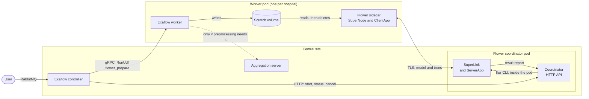
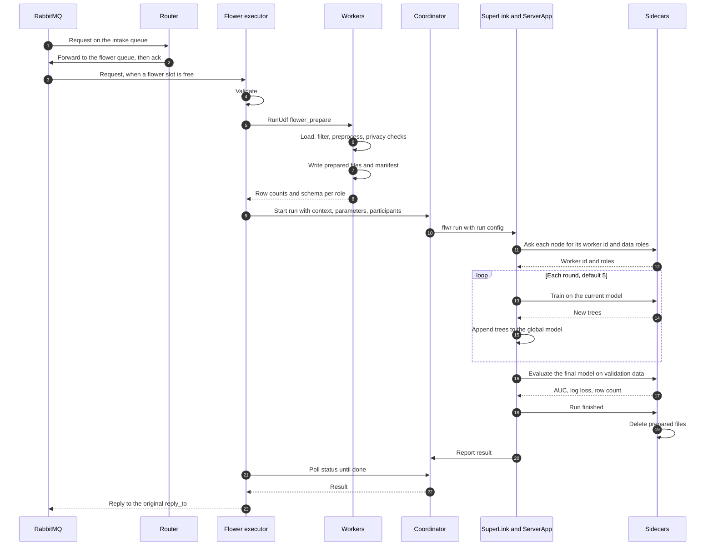
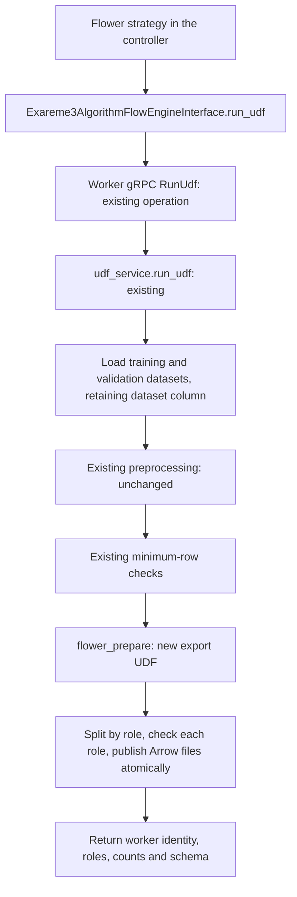
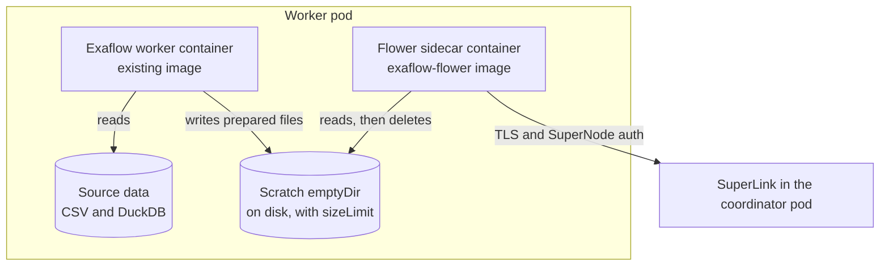
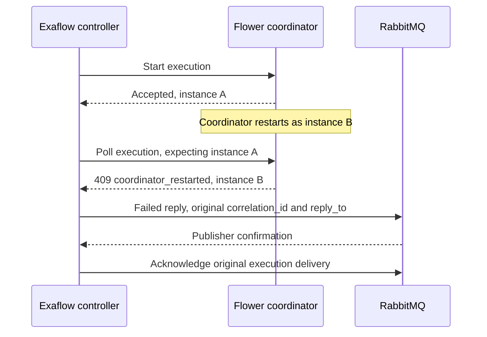
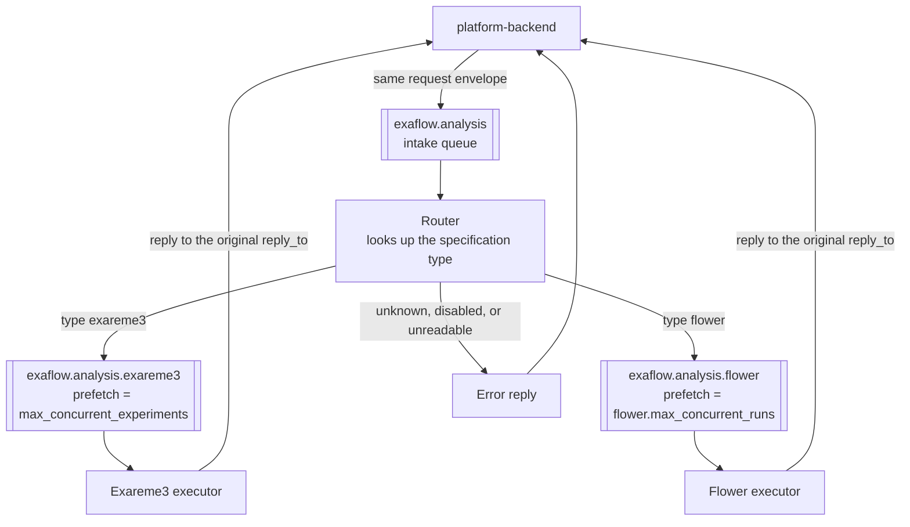

# Flower integration design

Status: implementation design for the agreed initial scope. Last updated:
2026-11-18. Read [plan.md](plan.md) first. [decisions.md](decisions.md) records the
chosen constraints; remaining technical recommendations are implementer-owned
starting points to resolve and test during the work. Runtime behavior described
here is not implemented or validated yet.

## Components

| Component | Where it runs | What it does |
| --- | --- | --- |
| RabbitMQ router | Central site, in the controller | Reads the intake queue and forwards each request to the `exareme3` or `flower` queue ([prerequisite P2](#prerequisite-analysis-intake-and-queues)) |
| Exaflow controller | Central site | Its Flower executor reads the `flower` queue. `FlowerStrategy` validates the request, picks workers, asks them to prepare data, starts the Flower run, waits for the result |
| Exaflow worker | Each worker pod | Loads and preprocesses data, runs privacy checks, writes prepared files |
| Aggregation server | Central site | Existing service; used only by preprocessing steps that need it |
| Flower coordinator | Coordinator pod | Small HTTP API: start, status, cancel, receive result |
| SuperLink and ServerApp | Coordinator pod | Flower's server. Sends models out, collects trees, runs the XGBoost rounds |
| Flower sidecar (SuperNode and ClientApp) | Each worker pod | Reads the prepared files, trains or evaluates, deletes the files at the end |

The controller talks HTTP/JSON to the coordinator. Controller-to-worker and
worker-to-aggregation-server traffic stays on the existing gRPC API.



## One analysis, step by step



## Data preparation

### Preparation framework contract

The role-aware fit/transform extension is **future work only**, covered by the
[separate PRD](prd/role-aware-preprocessing.md) and
[follow-up register](future-work.md#after-the-initial-implementation). C49/C50 keep
it out of the initial Flower integration. Its independent-evaluation protocol fits
on training data and transforms both training and validation with fitted state.

Initially, reuse current native preprocessing unchanged. Load the selected training
and validation rows, run the existing steps, then split/export by role. This can
let validation data influence learned preprocessing; do not describe the initial
path as a training-only fitted pipeline. No new fitting hooks, fitted-state
transport, or multi-phase preparation planner is required for the initial work.

### What already exists and what is new

Reuse the existing UDF call path and add the `flower_prepare` export UDF. No new
gRPC operation or protobuf change is required. The existing path loads rows,
runs inline preprocessing, checks minimum row counts, and calls a UDF. The new
UDF checks each exported role and atomically writes the prepared files.



| Reused unchanged | New in the initial integration |
| --- | --- |
| gRPC `RunUdf` and its protobufs | `flower_prepare` export UDF, registered with `@exareme3_udf` |
| Data loading and native preprocessing | Scratch-folder helper, atomic publication, and worker config/mount |
| Aggregation setup/cleanup from P3 | Input manifest and corresponding Flower reader |
| Existing privacy thresholds and aggregation unregistration | Role-specific export checks; fail if a selected worker/role is missing or insufficient |

The Flower strategy builds an `Exareme3AlgorithmFlowEngineInterface` with the
workers holding any requested training or validation dataset. It calls
`engine.run_udf(flower_prepare, add_dataset_variable=True, kw_args=...)`, carrying
the context ID, role-to-dataset selection per worker, and model columns.

When existing preprocessing needs aggregation, wrap preparation in P3's shared
`aggregation_context`. Its participant count includes every preparing worker,
including validation-only workers in this initial joint-preprocessing path.
Cleanup completes before Flower training starts.

On each worker, existing preprocessing runs before the export UDF. The UDF retains
role separation using the dataset column, checks each assigned role, writes a
hidden staging directory, and publishes the completed context directory by rename.
Return worker identity, roles, counts, and schema; the controller verifies the
complete preparation selection before requesting Flower execution.

Illustrative export body, not final code:

```python
@exareme3_udf
def flower_prepare(data, metadata, context_id, roles_by_worker, columns):
    worker_id = worker_config.identifier
    roles = roles_by_worker[worker_id]
    tables = {}
    for role, dataset_codes in roles.items():
        rows = data[data[DATASET_COL].isin(dataset_codes)][columns]
        check_min_rows(rows)
        tables[role] = pa.Table.from_pandas(rows, preserve_index=False)
    write_prepared_inputs(context_id, tables, metadata)
    return {
        "worker_id": worker_id,
        "roles": {role: table.num_rows for role, table in tables.items()},
    }
```

The existing engine skips a worker that raises `InsufficientDataError`; native
behavior stays unchanged. Flower must compare the returned worker IDs/roles against
the complete selection plan and fail if anything requested was skipped. Counts
from training and validation are never added together to pass the threshold.
The checks are per worker and assigned role, not a new per-dataset or per-class
privacy threshold.

C37: with a privacy minimum of 10, a worker with 8 training rows and 100 validation
rows makes the whole requested analysis fail. The user may submit a new request
omitting those training data while keeping the validation data. That request can
proceed if its other workers provide valid training data. No role is silently
dropped from an existing request. Inputs already prepared at other workers follow
the normal cancellation/expiry cleanup when preparation fails.

### Prepared files

```text
<scratch_root>/<context_id>/
    training.arrow       # only if this worker trains
    validation.arrow     # only if this worker validates
    manifest.json        # context, roles, schema, target mapping, row counts, expiry
```

- Binary Arrow IPC files, with only the model features and the outcome. No
  identifiers that preparation needed (for example the `dataset` column).
- Categories use the same encoding on every worker, taken from the data-model
  metadata, so XGBoost sees identical columns everywhere.
- **Cleanup.** The reader deletes. When the ServerApp sends "run finished", each
  ClientApp deletes its context folder. Runs that end without that message
  (failure, cancellation, restart) leave a folder behind. The worker deletes
  expired folders at the start of the next `flower_prepare` call. The volume's
  `sizeLimit` bounds scratch usage but is not a retention schedule. Pod replacement
  clears the volume; restarting a container within the same pod does not. See
  [Kubernetes volume lifetime](https://kubernetes.io/docs/concepts/storage/volumes/#how-volumes-work).

## Inside a worker pod



- Only the worker container mounts the source data. The sidecar sees only the
  scratch volume.
- **Readiness.** Kubernetes marks a pod ready only when every container is ready.
  The controller finds workers through the headless `exaflow-workers-service`,
  which hides pods that are not ready. C41 selects whole-pod exclusion: if either
  the native worker or Flower sidecar is unready/unhealthy, the pod is ineligible
  for analyses. Both components have readiness and liveness checks.
- **Resources.** The sidecar has its own CPU and memory limits to bound XGBoost's
  resource use. These alone do not guarantee native throughput: scheduling, shared
  disk, and concurrent runs also matter. XGBoost's thread count matches the
  sidecar's CPU budget.
- **Scratch volume.** `emptyDir` on disk (not `medium: Memory`, which counts against
  pod memory) with a `sizeLimit`.

### Worker pod health

C41 is confirmed. Keep normal ready-only worker discovery; do not enable
`publishNotReadyAddresses`. Exclude an unready pod through discovery/landscape
refresh rather than deleting the pod or its data as a readiness action.

- Native readiness checks the gRPC service and loaded data/metadata. Flower
  readiness checks that the runtime is usable and its SuperNode can participate.
  Use supported probe interfaces from the pinned release.
- Liveness checks local process health. A remote SuperLink outage can make Flower
  unready without forcing a restart of an otherwise healthy sidecar process.
- With Flower enabled, this intentionally couples native eligibility to Flower
  readiness: a Flower outage can remove worker pods from native analyses too.
  With Flower disabled, only the native worker's health determines readiness.
- Coordinator readiness checks its own backend/startup cleanup, not all workers'
  readiness. Validate selected participants when launching a run, avoiding a
  circular startup dependency between coordinator and workers.
- Test exclusion and re-admission through existing landscape refresh behavior.
  Readiness changes do not imply instantaneous cancellation of an already-running
  request; in-flight failures follow existing worker/run failure handling.

See Kubernetes [pod readiness](https://kubernetes.io/docs/concepts/workloads/pods/pod-lifecycle/#pod-conditions).

## How Exaflow uses Flower

- **Long-running services.** SuperLink runs in the coordinator pod. One SuperNode
  runs in each sidecar. Both start with their containers and stay up. A run starts
  ServerApp and ClientApp processes inside these containers (Flower's subprocess
  mode). There are no per-run containers or Kubernetes Jobs.
- **Use Flower's own commands.** Containers start `flower-superlink` and
  `flower-supernode` directly, with arguments from Helm. No wrapper is needed.
- **Worker identity.** Each SuperNode starts with
  `--node-config "worker-id=<exaflow worker id>"`. At the start of a run the
  ServerApp sends one `query` message to all nodes. Each ClientApp answers with
  `context.node_config["worker-id"]` and the roles in its manifest for this context.
  The ServerApp then sends training messages only to training participants and the
  evaluation messages to validation participants. Validation may use multiple
  workers. Check context/worker identity before using its files; an unselected node
  has no role for this context. C44 defers enhanced participant-selection and
  complete-round reply enforcement until after the initial integration.
- **Per-run settings.** The coordinator passes the context ID, the algorithm
  parameters, and the participant list with `flwr run --run-config`. Run-config
  values must be simple types, so the participant list travels as a JSON string.
- **Rounds.** `FedXgbBagging`: in each round, every training participant trains new
  trees on its own data, starting from the current global model. The server appends
  them to the global model.
- **Timeouts.** Every send-and-wait call in the ServerApp has a timeout. A
  run failure reported by the runtime propagates without analysis resubmission.
  C44 defers enhanced fail-on-any-selected-participant enforcement. Partly trained
  clients are not retried by a new application policy.
- **Version.** Pin the exact Flower version. Flower renames APIs often (for example
  `Driver` to `Grid`, and the Exec API to the Control API). Keep every call to the
  `flwr` CLI in one small coordinator module, so an upgrade touches one place.
- **Testing.** The ServerApp and ClientApp are tested first with Flower's simulation
  mode or a local SuperLink with two SuperNodes, before kind and Helm.

## Coordinator API

| Operation | Endpoint | Caller |
| --- | --- | --- |
| Start a run | `POST /executions/{context_id}` | Controller. Repeating the same request returns the existing run; different content for an existing context is rejected |
| Status and result | `GET /executions/{context_id}` | Controller |
| Cancel | `POST /executions/{context_id}/cancel` | Controller |
| Report result | `POST /executions/{context_id}/completion` | ServerApp, from inside the pod |
| Health | `GET /livez`, `GET /readyz` | Kubernetes |

- The start request has the request ID, algorithm ID, parameters, deadline, and the
  participants with their roles. It never carries data or file paths. The
  coordinator maps an enabled algorithm ID to a fixed local app catalog in its
  image. Unknown IDs, external bundles, upload/URL/path inputs, and caller-selected
  Python entrypoints are rejected. Algorithm parameters cannot override app lookup
  or CLI component selection.
- Records stay in memory and expire after a fixed time. There is no explicit
  release call, no progress reporting, and no algorithm catalog.
- The ServerApp's result report is the main signal that a run finished. A slow
  background check with `flwr ls --format json` catches runs that died without
  reporting. The coordinator calls the CLI with argument lists, never through a
  shell.
- A run counts as successful only when the result report and Flower's final run
  state agree.
- Revised C42: only transient failures reading
  `GET /executions/{context_id}` may retry. Use at most two retries after the first
  attempt, with delays of 0.5 and 1 second, bounded by the execution's remaining
  deadline. Retry connection interruption/refusal, connect/read timeouts, and
  HTTP 502/503/504 without a structured terminal execution error. Reuse the same
  context ID and expected coordinator instance on every read.
- A detected coordinator restart, lost context, explicit run failure, other HTTP
  errors, invalid response, or exhausted status-read budget is terminal. Attempt
  start/cancel/reset/CLI operations once. Do not retry router forwarding or submit
  a replacement analysis. Successful status calls continue normal polling while
  the run is pending/running; the retry budget applies to each failed status read,
  within the overall execution deadline.

C40 confirms one internal maintenance operation, `POST /runtime/reset`, called by
the controller during startup before its Flower consumer starts. This is scoped to
this deployment's dedicated runtime, not a public cancellation API. Its admission
barrier and startup behavior are described under
[restart cleanup](#restart-cleanup).

## Concurrency

XGBoost uses a lot of CPU on the sidecars, which share nodes with the workers.
Flower runs therefore have their own limit, separate from
`max_concurrent_experiments`.

- New config key `flower.max_concurrent_runs` (Helm value of the same name). Default
  1; up to 2 is reasonable.
- Normal admission uses the prefetch of the `exaflow.analysis.flower` queue, with
  no controller semaphore. Waiting Flower requests do not consume native executor
  slots. C48 additionally requires atomic coordinator admission accounting for
  pending CLI starts, running jobs, and work whose termination is uncertain. Reject
  an excess start with HTTP 429 / `flower_capacity_exceeded` and propagate it as a
  terminal failure without retries. Hold a live job's slot until termination is
  established. R14 still needs to establish termination through restarts.
- The queues and the router come from
  [prerequisite P2](#prerequisite-analysis-intake-and-queues).

## Security setup

C39 confirms direct access inside the protected Kubernetes deployment, with no
additional reverse proxy, trusting permitted workloads and operators. SuperLink's
Runtime, Fleet, and Control APIs share one
HTTP listener, default port 8000 in the targeted Flower release. Expose that
listener only inside the cluster; the coordinator uses it through the CLI and
sidecars use it for Fleet communication. See the
[Flower network reference](https://flower.ai/docs/framework/ref-flower-network-communication.html).

The CLI is a local command in the coordinator container, not a separately exposed
server. The access boundaries are:

| Endpoint/process | Intended access |
| --- | --- |
| Coordinator HTTP API | Exaflow controller |
| Flower CLI | Executed locally by the coordinator |
| SuperLink shared HTTP listener | Coordinator and permitted Flower worker pods |
| SuperNode local Runtime API | Local ClientApp/SuperExec processes in the worker pod |

The shared SuperLink port is not coordinator-only: sidecars need it too. Under C39
there is no HTTP-route isolation between those permitted callers. This is adequate
only for the selected trusted-workload boundary, not a claim that workers cannot
reach Control API routes.

**Installed algorithms are an integration restriction, not a Flower guarantee.**
Normal Exaflow/coordinator requests can execute only the local catalog above.
Flower itself supports submitting Flower App Bundles containing application code
through its CLI/Control API. A caller with direct submission access can therefore
submit code not originally installed as one of our algorithms; preinstalled
dependencies alone do not form an app allowlist. The no-proxy design depends on
trusting permitted callers not to bypass the coordinator. Do not describe the
container image as preventing all external app execution. See
[Flower app submission](https://flower.ai/docs/framework/how-to-use-cli-json-output.html)
and [app bundles](https://flower.ai/docs/framework/how-to-configure-pyproject-toml.html).

In this topology, direct callers could be the coordinator, code running in an
allowed worker pod, or an operator able to execute commands in those pods.
Containers in a worker pod share its network access, so this includes the native
worker container. A cluster administrator can also change those access rules.
Ordinary platform users submitting analysis requests have no app-upload route
through Exaflow. A normal ClientApp does not submit arbitrary apps; bypassing the
coordinator requires an explicit submission by another caller.

The upload destination is SuperLink itself. For a local app, `flwr run` packages
the caller's application files into a Flower App Bundle (FAB) and submits it
through the Control API; the runtime makes that bundle available to the app
processes. No upload to an internet service is necessary. The CLI is an HTTP client,
so disabling the underlying submission API would disable CLI submissions too.
SuperLink cannot distinguish an authorized CLI request from an equivalent HTTP
request based on the caller using the CLI executable. Enforcing coordinator-only
submission would require caller authorization or API-route access filtering;
neither is introduced by this clarification to the selected no-proxy topology.

Internet access is a separate concern. An incoming worker request does not remotely
invoke the coordinator's CLI or make it choose an arbitrary URL; our coordinator
selects the fixed local app. A caller that bypasses it can use its own CLI or the
Control API to upload an app bundle to SuperLink. That bundle can contain the code
already, so it does not require the coordinator to download anything from the
internet. Flower's CLI also accepts remote app specifications, but outbound access
depends on the caller/runtime network policy. Do not equate private ingress with
denied internet egress, or denied egress with an installed-app execution allowlist.
The initial deployment still requires no internet access for its normal algorithm
flow because its apps/dependencies are built into the release image. An explicit
egress restriction can use the existing NetworkPolicy mechanism; it has not been
selected as a separate new requirement here.

1. **Network boundary.** Use an enforced default-deny policy and allow only the
   required controller/worker pods and ports. Do not expose SuperLink through a
   public Ingress or external Service. Limit who can create or relabel pods in the
   allowed namespaces. NetworkPolicies govern network connections, not HTTP paths.
1. **TLS.** SuperLink presents a certificate for its Service name and clients trust
   its CA. Keep credentials in Secrets. Local SuperNode Runtime APIs remain bound
   to localhost. No extra proxy or account/OIDC service is introduced.
1. **SuperNode authentication.** C29's existing choice remains in place pending a
   specific decision to remove it. It uses per-sidecar keys and coordinator CLI
   registration, repeated after SuperLink loses its in-memory state. It rejects an
   unregistered client that happens to reach the listener. It does not authenticate
   Control API callers or restrict which HTTP routes a permitted pod can access.
1. **Sidecar hardening.** Run as non-root with a read-only root filesystem, give
   Flower a small writable home volume, drop unnecessary capabilities, and avoid
   mounting service-account credentials in containers that do not need them.

The trust assumption is explicit: all pods/operators allowed to reach SuperLink
are trusted with its shared endpoint. Coordinator-only submission is the intended
application flow, not route-level access control enforced by this topology. For
example, compromised code in an allowed worker pod can reach the shared listener;
node authentication alone does not prevent it attempting Control API operations.
An accidentally started, unregistered SuperNode is the narrower case node
authentication helps reject. Signed-app verification remains excluded.

R17 recommends treating node authentication as optional in the fully trusted
initial deployment. The existing C29 choice remains until explicitly changed;
the user's question about its value is not itself that decision. See Kubernetes
[NetworkPolicies](https://kubernetes.io/docs/concepts/services-networking/network-policies/).

## XGBoost and privacy

### Who sees what

| Party | Sees |
| --- | --- |
| Coordinator pod (ServerApp) | Every tree from every hospital |
| Each training hospital | The combined model each round, including other hospitals' trees |
| Validation hospital | The final combined model |
| User | Metrics only |

XGBoost trees leak data-derived values. Split points come from local data and can
equal a real patient value, for example an exact age. Leaf values describe the
outcome of the patients in that leaf. The model never reaches the user, but the
coordinator and the hospitals see it. This needs a privacy sign-off before release.

### Settings

The target is one categorical outcome with exactly two declared levels. The
required `positive_class` must be one of them; map it to 1 and the other level to
0 using the same mapping at every worker. Reject additional/unknown levels and
missing outcome values rather than converting extra classes to 0. A training
worker may observe just one of the two levels locally; this does not introduce a
per-class privacy threshold. C46 fixes the two-level contract, not a requirement
that each training worker contains both classes.

| Setting | Value | Who sets it | Why |
| --- | --- | --- | --- |
| `positive_class` | required | User | Which outcome level counts as positive |
| `num_rounds` | 5 | User | Federated rounds |
| `local_rounds` | 1 | User | Trees per participant per round |
| `learning_rate` | 0.1 | User | |
| `max_depth` | 6, also the maximum | User | Deeper trees describe smaller groups; 8 allows 256 leaves |
| `seed` | 0 | User | Repeatable runs |
| objective | `binary:logistic` | Fixed | |
| tree method | `hist`, CPU | Fixed | |
| `base_score` | 0.5 | Fixed | Otherwise XGBoost estimates it from each hospital's data, which reveals local class balance and makes models inconsistent |
| `min_child_weight` | `minimum_row_count / 4` | Fixed, from worker privacy config | Lower bound on training rows supporting a leaf under the assumptions below |
| `max_bin` | 32 | Fixed | Limits how precisely split points reflect individual values |
| threads | sidecar CPU limit | Runtime config | |

> **Technical detail: the `min_child_weight` floor.** For binary logistic loss, each
> row adds `p(1−p) ≤ 0.25` to a leaf's hessian sum. A leaf needs a sum of at least
> `min_child_weight`, so it holds at least `4 × min_child_weight` rows. Setting
> `min_child_weight = minimum_row_count / 4` (2.5 for the current threshold of 10)
> bounds support in training rows under unit sample weights, fixed
> `scale_pos_weight=1`, and the stated binary logistic objective. It does not prove
> a count of distinct patients or prevent model disclosure. Users cannot lower it.
> See [XGBoost parameter definitions](https://xgboost.readthedocs.io/en/stable/parameter.html).

### Result

C45 selects `n_train`, `n_evaluation`, `log_loss`, `rounds_completed`, and
`evaluation_by_worker`. Each worker entry contains `worker_id`, `n_evaluation`,
`auc`, and its local `log_loss`. There is no combined `auc` field and no average
of local AUCs. Sort the worker entries by worker ID.

Each validation worker evaluates the same final global model and positive-class
mapping. If worker `i` evaluates `n_i` rows and returns mean log loss `l_i`, the
pooled result is `sum(n_i * l_i) / sum(n_i)`, and `n_evaluation = sum(n_i)`.
Prediction/label rows stay local; the coordinator combines only metrics and counts.
All workers use the same log-loss definition and probability clipping convention.

A local AUC needs both outcome classes. Recommended handling for a one-class
validation worker is `auc: null` plus `auc_unavailable_reason: single_class`, while
retaining its valid log loss and row count in the pooled result. This edge-case
handling is a technical recommendation, separate from the confirmed C45 output
choice. Never emit a fabricated AUC or non-finite JSON value. The old `AUC`,
`initial_auc`, and `auc_ascending` fields are replaced without aliases.

## Failures and cleanup

| Event | Behavior |
| --- | --- |
| Normal completion | Controller gets metrics. Sidecars delete prepared files. Coordinator record expires |
| Failure or cancellation | Coordinator stops the Flower run. Aggregation context is cleaned up. Leftover files are removed at the next preparation |
| Controller restart | C40: reset/cancel owned old runs before the Flower consumer restarts; unacknowledged requests are then redelivered as fresh attempts |
| Coordinator container restart | In-memory records are lost; the separate SuperLink may keep running. R14 proposes cancelling surviving runs before coordinator readiness |
| SuperLink restart | Its in-memory runtime state is lost. The coordinator fails affected attempts; runtime and local-app cleanup must complete before replacement admission |
| Worker or sidecar restart | Propagate failures surfaced by the initial runtime; do not automatically submit a replacement analysis. C44 defers stricter fail-on-any-participant enforcement |
| RabbitMQ redelivery | Follows the existing intake rules. A new attempt gets a new context |
| Router crash after forwarding, before the ack | The intake message is redelivered and the request runs twice. The current contract already allows duplicates |

Every run has its own deadline inside Flower, so abandoned runs cannot run forever.

The [failure-flow board](failure-board.md) expands this into stage-by-stage
detection, notification, response, and cleanup responsibilities. The controller
publishes analysis replies; the coordinator does not publish to RabbitMQ or push
failure notifications to a controller that has crashed. Controller restart follows
C40's fresh-attempt redelivery behavior rather than guaranteeing a failure reply
for the interrupted attempt.

### Restart cleanup

C40 confirms the controller-startup reset. R14's coordinator-startup cleanup and
failure-signalling details below remain recommendations. Both assume the existing
single-controller deployment and a SuperLink dedicated to this integration.

- **Controller startup:** before starting the Flower executor consumer, request
  an idempotent reset keyed by this controller startup's unique ID. The coordinator
  closes Flower admission, cancels its pending submissions, lists all nonterminal
  owned runs through the CLI, stops them, and waits for cleanup. Only after reset
  succeeds does the Flower consumer start. Native execution and metadata need not
  wait for this Flower-specific barrier. Never purge the RabbitMQ queues.
  This gate applies when replacement Flower execution is enabled. During the C38
  prerequisite/unavailable state, the terminal error path remains usable without
  a coordinator or reset; do not block those error replies on a missing runtime.
- **Already-started work:** cancel it and discard partial training progress. Do not
  adopt or resume it. AMQP requests still unacknowledged are redelivered and use new
  attempt contexts after the barrier. Requests whose replies were acknowledged
  stay complete; the existing confirmation/ack race can still produce duplicates.
- **Coordinator startup:** its record dictionary is empty, but SuperLink can still
  have runs. Keep readiness/admission closed, query the dedicated backend, cancel
  surviving nonterminal runs, then become ready. A still-running controller fails
  its lost attempts with an execution-lost error; coordinator restart alone does
  not automatically requeue an already handled request.
- **Races:** serialize reset and submission. Repeated reset calls for the same
  controller startup must not cancel newly admitted work. Fence delayed submissions
  from the old controller/runtime generation; these IDs describe ownership within
  this release, not service-version compatibility.
- **Cleanup proof:** CLI stop plus terminal run status is the first mechanism to
  test. Confirm the chosen runtime also stops local calls/readers before admitting
  replacements or deleting their files. If cleanup cannot be established within a
  bounded timeout, keep Flower unavailable instead of announcing a successful
  reset. Existing execution deadlines remain the independent fallback.
  C42 adds no retry for a failed reset/list/stop call. Propagate that error and keep
  Flower unavailable if startup cleanup cannot be established. Failure reporting
  alone is not proof that an already-started remote process stopped.

No database or saved model is required: this deliberately cancels work instead of
recovering it. Prefetch remains normal queue admission. C48 confirms coordinator
accounting for pending/running/uncertain jobs as an additional guard. Neither
admission accounting nor a reported failure proves that local processes stopped.

### Controller-visible coordinator restart failure

Recommended flow under R14: detect loss through the existing status calls, without
trying to recover the old execution or pushing a notification from lost state.

1. The coordinator generates a random `coordinator_instance_id` at process startup.
   Successful start/reset responses include it. This is ephemeral process identity,
   not a service version, specification hash, or persisted execution record.
1. The controller stores it beside the accepted attempt's `context_id`. Subsequent
   status/cancel calls include the expected instance ID in an internal header.
   No submission is automatically repeated after a failure under C42.
1. A transient connection error, startup 503, or request timeout on a status read
   uses C42's bounded read retry budget. If the budget or execution deadline is
   exhausted, fail as `flower_coordinator_unavailable`. Other operations still
   fail immediately. These errors do not prove a restart, so retain that
   distinction in the message.
1. A restarted coordinator has a different instance ID. A call expecting the old
   one receives HTTP 409 with `code: coordinator_restarted` and the new identity,
   before any context lookup or creation. The empty coordinator need not remember
   that particular old execution. An accepted context missing from the same live
   instance instead returns a distinct `execution_lost` error.
1. The controller maps either loss response to `FlowerExecutionLostError`. The
   Flower executor publishes the normal failed analysis envelope, with public
   error code `flower_execution_lost`, to the original `reply_to` and preserves
   `correlation_id`. Only after reply confirmation does it acknowledge the AMQP
   delivery. Update the shared error mapping so this does not become a vague
   `internal_error`.
1. Do not automatically submit a replacement run for a lost context. A failed
   operation is terminal for the current attempt. Sending its failure reply uses
   the existing AMQP delivery/settlement contract; this plan adds no recovery or
   replay policy. A later explicit user submission is a fresh attempt.



Coordinator-startup orphan cancellation happens independently behind its readiness
barrier. These status errors report that the original attempt was lost; they do
not claim its local processes have already finished or authorize early file deletion.

## Project layout and specifications

```text
exaflow/
    controller/services/flower/        # Flower strategy and coordinator HTTP client
    algorithms/exareme3/flower/        # flower_prepare UDF
    worker/flower/                     # scratch folder helper (atomic write, expiry)
exaflow-flower/                        # independent project, own uv.lock, Python 3.12
    pyproject.toml
    Dockerfile
    exaflower/
        coordinator/                   # HTTP API, run records, flwr CLI adapter
        worker/                        # prepared-input reader for ClientApps
        algorithms/
            xgboost/
                xgboost.json           # the only maintained specification
                server_app.py
                client_app.py
                task.py
    tests/
```

- The Flower project never installs or imports the root `exaflow` package. Root code
  never imports Flower or XGBoost.
- Each Flower algorithm's JSON specification lives beside its code. A build step
  copies only the JSON into the controller image. At startup the controller loads it
  through `AlgorithmSpecification`, like any other specification. `type: flower`
  selects the Flower strategy. A build test checks that the copy matches the source.

## Images and deployment

One image, three start commands:

| Container | Image | Command | Placement |
| --- | --- | --- | --- |
| Coordinator | `exaflow_flower:<release>` | `exaflow-flower-coordinator` | Coordinator pod, 1 replica |
| SuperLink | `exaflow_flower:<release>` | `flower-superlink` | Same coordinator pod |
| Sidecar | `exaflow_flower:<release>` | `flower-supernode` | Each worker pod |
| Worker | `exaflow_worker:<release>` (existing) | unchanged | Each worker pod |

The SuperLink container needs the XGBoost dependencies too, because the ServerApp
runs inside it.

C47 selects `strategy.type: Recreate` for normal upgrades of the controller and
Flower coordinator Deployments, with one active coordinator application process.
For each Deployment, Kubernetes waits for its old pods to terminate before creating
the new revision. Expect a short interruption. This avoids ordinary rolling-update
overlap; retain C40's startup reset and generation checks. It is not a general
distributed ownership guarantee for manual replacement or partitioned processes.

Helm changes when `flower.enabled` is true:

- Coordinator Deployment with the coordinator and SuperLink containers. A Service
  for the coordinator HTTP port and one for the Fleet API.
- Sidecar container and scratch `emptyDir` in the worker StatefulSet. The worker
  container mounts the scratch volume too.
- NetworkPolicies, TLS Secret, and SuperNode key Secrets.
- Values: `flower.max_concurrent_runs`, image, scratch `sizeLimit`, sidecar and
  coordinator resources.
- The old `flower.execution_timeout` and `flower.server_port` values are removed.

C39 excludes an extra reverse proxy. C40 gates Flower consumer startup on successful
reset. C41 uses readiness probes for both worker containers and excludes an unready
pod from normal discovery. R14 additionally proposes coordinator-startup orphan
cleanup and explicit execution-loss signalling; those details remain recommendations.

## Prerequisite: global-worker removal

Prerequisite P1. It happens before Flower work, as its own change. It has to cover:

| Today | What removal must change |
| --- | --- |
| Old Flower strategy needs a global worker for its server | Deleted together with the old Flower code |
| Validation datasets are eligible only on the global worker | Any worker can hold validation datasets |
| Worker selection skips `globalworker` by name | No name-based exclusion |
| Request validation rejects validation datasets without a global worker | Validation checks only that the datasets exist |
| Worker registry and protobufs split workers by role | One kind of worker |
| Helm, local deployment, and fixtures have global-worker resources | Removed or merged into normal workers |
| SMPC config gives the global role coordinator settings | Moved to an explicit SMPC setting |
| Local deployment gives the global role a special privacy setting | No worker gets a relaxed privacy policy |

Code to start from:
[landscape](../../exaflow/controller/services/worker_landscape_aggregator/worker_landscape_aggregator.py),
[request validation](../../exaflow/controller/services/api/analysis_request_validator.py),
[old Flower strategy](../../exaflow/controller/services/flower/strategies.py),
[deployment generation](../../tasks.py), and
[global-worker chart](../../kubernetes/templates/exaflow-globalworker.yaml).

## Prerequisite: analysis intake and queues

Prerequisite P2. It changes how every analysis arrives, not only Flower ones, so it
lands before Flower work as its own change.

### One way in per deployment

New deployment setting `analysis_intake: rabbitmq | http`. Helm defaults to
`rabbitmq`. The controller logs the mode at startup.

| | `rabbitmq` mode (production) | `http` mode (testing and manual runs) |
| --- | --- | --- |
| `POST /analysis` | Off. Returns an error saying analyses are not accepted over HTTP | On |
| Queue consumers | Router, `exareme3` executor, `flower` executor | Not started |
| Limits | Executor queue prefetch, plus C48's live Flower admission check | No controller intake limit; C48 still applies to Flower starts |

- Only `/analysis` switches. platform-backend also reads `/specifications/*`,
  `/data_models_attributes`, `/cdes_metadata`, and `/datasets_variables` over HTTP.
  Those stay on in both modes.
- `http` mode has no controller intake limit. It is for testing and manual runs
  only; C48's runtime capacity check still applies to Flower starts. The deployment
  docs warn against using this intake mode in production.
- `analysis_slot`, the concurrency semaphores, and the "capacity exceeded" 503 are
  deleted. Queue prefetch controls consumer delivery. C48's separate coordinator
  admission guard limits live Flower work; it does not restore a controller
  semaphore or add an execution queue in the coordinator.

### Queues and router



- **Producer protocol stays the same; the default intake name changes.** C31 uses
  `exaflow.analysis`. The current repository default is
  `exaflow.analysis.requests`; update producers/configuration during rollout.
  Message bodies, correlation IDs, and reply routing retain their format. Producers
  never need the other two queue names. No legacy binding/alias is planned.
- **The router stays thin.** It reads the algorithm name, looks up the
  specification type, and forwards the message unchanged, keeping `reply_to` and
  `correlation_id`. The intake queue can use a small prefetch because routing is
  fast.
- **The router rejects only what it can see.** A missing or disabled algorithm, or
  a message without a readable algorithm name, gets an error reply built with the
  existing reply code, so platform-backend sees the usual error shape. Inputs,
  parameters, datasets, and preprocessing are validated only in the executors.
- **Confirmed forwarding.** The router acks intake only after successful handoff.
  R16 specifies mandatory routing plus confirms/returned-message handling, since a
  confirm alone does not establish routability. Reuse the publisher-confirm/error
  mechanisms in `exaflow/controller/services/rabbitmq/consumer.py` and retain their
  existing reply settlement guarantees.
- **Same handling everywhere.** Both executor queues get the same durability,
  dead-lettering, and redelivery settings as the intake queue.
- **Both queues from the start.** P2 creates both executor queues. Until the
  replacement Flower integration is ready, a request for a known Flower algorithm
  receives a terminal `FlowerUnavailableError` with a clear message. It uses the
  existing failure-reply envelope and is acknowledged only after the error reply
  is routed and confirmed. It does not invoke the old strategy or requeue forever.
  In HTTP test mode the same condition returns a service-unavailable response.
  This is an explicit availability error, separate from the removed capacity 503.
  Keep unavailable Flower algorithms out of the enabled specification catalog,
  while recognizing known IDs for this diagnostic. Other algorithm IDs retain
  existing unknown/disabled-algorithm validation. Native execution stays available
  regardless of which prerequisite PR lands first.
- **Testing.** At least one prod-environment suite runs in `rabbitmq` mode, building
  on `tests/prod_env_tests/test_rabbitmq_analysis.py`. Other suites may use `http`
  mode.

### Queue creation and ownership

Queues are resources managed by RabbitMQ, but creation is triggered by an explicit
declaration. Declaring a missing queue creates it; declaring an existing queue
with matching settings reuses it. Publishing to a queue name does not itself
create that queue. Queues may also be provisioned through broker definitions or
management tooling, but this repository currently uses application declarations.
See [RabbitMQ queue declarations](https://www.rabbitmq.com/docs/queues).

| Queue | Current/planned declaring owner | When |
| --- | --- | --- |
| Current request queue and dead-letter queue | Existing Exaflow controller consumer | AMQP connection setup, before consuming |
| Planned `exaflow.analysis`, `exaflow.analysis.exareme3`, and `exaflow.analysis.flower`, plus dead-letter queues | Exaflow controller's P2 topology setup | Before starting router/executor consumers in RabbitMQ intake mode |
| Producer-specific `reply_to` queue | The producer, such as platform-backend | Before submitting its request |

P2 should centralize declarations and settings so router and executors do not
declare the same named queue with conflicting attributes. The broker validates
type/durability/arguments; mismatches are configuration errors. Existing durable
queues are reused on controller restart. A plain broker deployment does not infer
our three queue names; no extra deployment job is required for the application
declaration approach. HTTP intake mode need not create these queues.

This follows the current
[consumer setup](../../exaflow/controller/services/rabbitmq/consumer.py), which
declares the request/dead-letter queues. The
[producer example](../../examples/rabbitmq_analysis.py) creates its reply queue;
Exaflow passively checks that destination exists rather than creating arbitrary
producer reply queues. Queue-limit enforcement remains in RabbitMQ even when the
declaration arguments come from Exaflow settings.

### Dead-letter and reply queues

A dead-letter queue stores request messages that cannot be handled through the
normal request/reply path and are rejected without requeueing. RabbitMQ routes
them through the configured dead-letter exchange/routing key to the dead-letter
queue. In Exaflow examples include missing reply routing metadata or a missing
reply destination. Retain them for diagnosis under the configured size/retention
limits; there is no new automatic replay/retry consumer under C42.

The current default name is `exaflow.analysis.dead`, configurable through
`rabbitmq.dead_letter_queue` in the
[controller configuration](../../exaflow/controller/config.toml). When RabbitMQ
intake connects, the consumer declares this queue before consuming requests; an
error is not needed to create it. For example, one producer can submit a request
whose `reply_to` queue was never declared or was deleted. Exaflow's passive check
fails and it rejects the original request without requeueing, sending it to the
dead-letter queue even when there is no backlog. Missing correlation/reply metadata
or a reply destination disappearing/rejecting the publication are other existing
cases. The
[real-broker tests](../../tests/prod_env_tests/test_rabbitmq_analysis.py) cover
missing metadata, absent/deleted reply queues, and rejected replies.

An ordinary algorithm failure still produces a failed response on `reply_to` and
acknowledges the request once that response is confirmed. It does not automatically
become a dead-lettered message. Queue/message expiry and other broker policies can
also trigger dead-lettering when configured; not every overflow mode does so. See
[RabbitMQ dead lettering](https://www.rabbitmq.com/docs/dlx).

`reply_to` is the producer-chosen destination queue name, not a requirement for a
queue per response. A producer may reuse one reply queue for many requests and
match replies using `correlation_id`. The current example CLI chooses one durable
queue per logical request, named `exaflow.analysis.replies.<request_id>`; that is
an example producer lifecycle, not an Exaflow requirement. Duplicate replies can
share that same queue under the existing at-least-once delivery contract.

There is no controller-wide configured `reply_to` name. The actual platform-backend
reply queue name depends on that producer and cannot be established from this
repository's example alone.

`reply_to` is message metadata, not a queue declaration. RabbitMQ routes the request
to the analysis queue without checking whether this separate reply destination
exists. A producer bug can therefore put an undeclared or misspelled queue name
there, or publish despite its queue declaration failing. This is not expected from
the normal producer flow: await a successful reply-queue declaration and use the
returned name before publishing, as the example already does. A destination that
existed at publication can still disappear later; Exaflow's existing checks handle
both cases.

For a long-running backend, a producer-owned reply queue shared across its requests
with correlation-ID matching is a suitable option. Exaflow does not choose or
create that destination: it checks the supplied queue exists and publishes there.
No change to an existing producer's choice is required by the Flower integration.
See the [RabbitMQ RPC pattern](https://www.rabbitmq.com/tutorials/tutorial-six-python).

### Router failure cases

These are exceptional forwarding conditions, not the normal situation where one
or two Flower executions are busy. Prefetch limits delivered/unacknowledged jobs;
the durable executor queue can still store many waiting requests. A full queue is
plausible after prolonged executor downtime, sustained automated traffic above
execution throughput, or an accidental publish loop. It is not expected from a
small number of interactive analyses.

For scale only: at the current 256 MiB body-size limit and illustrative 4 KiB
requests, roughly 65,536 waiting requests fit. Actual capacity depends on request
sizes and broker policy. This is not an estimate of observed production traffic.
See [RabbitMQ queue length limits](https://www.rabbitmq.com/docs/maxlength).

RabbitMQ enforces the bound and overflow behavior. These may be configured by
broker policy or queue-declaration arguments. The current Exaflow consumer already
declares `x-max-length-bytes` from `rabbitmq.queue_max_bytes` and `x-overflow` as
`reject-publish`; the settings are supplied by Exaflow but executed by the broker.
No new application-side queue counter is proposed. C43 requires only handling
the broker's rejection as a terminal availability/overload error.

R16 proposes mandatory/confirmed forwarding; C42/C43 determine error behavior:

1. **Confirmed but unroutable.** A publisher confirm can mean the broker accepted
   the publish even though no queue matched. Without `mandatory=True`, the router
   can then acknowledge the intake message and lose the request. Forward with
   mandatory routing, enable returned-message errors on the isolated publish
   channel, and consider forwarding successful only after a positive confirm with
   no return. Keep persistent delivery and all required original properties.
   A concrete example is publishing to the default exchange with a queue-name
   routing key before that queue was declared, after it was deleted, or with a
   typo in its name. The exchange exists, but no queue matches. An offline consumer
   alone is different: its durable queue can still accept waiting requests.

1. **Destination cannot accept the request.** Executor queues retain bounded size
   and reject-publish overflow. If the Flower destination is full, forwarding gets
   a negative confirmation. C43 propagates the error instead of holding a router
   delivery slot indefinitely. C42 adds no forwarding retry or buffering policy.

C43 selects a terminal transport-availability reply after a
known negative confirmation or mandatory return. Use the existing reply envelope,
preserve `correlation_id`/`reply_to`, and acknowledge intake only once that error
reply is routed and confirmed. A known capacity rejection can be reported as
overload; a bare broker nack need not reveal its cause, so do not claim that every
nack means a full queue. This failure handling does not add input/parameter
validation to the router. A later explicit client submission is a fresh attempt.

A lost connection or confirmation timeout has an uncertain forwarding outcome.
Propagate the forwarding failure without repeating the publish, and do not claim
it never executed. Acknowledge intake only after a terminal error reply is routed
and confirmed. If a broker connection failure prevents that reply/acknowledgement,
the existing AMQP settlement rules still apply: an unacknowledged delivery can be
redelivered by RabbitMQ. This is not a new application retry or an exactly-once
guarantee. Do not add a forwarding retry/backoff loop or pretend an undelivered
error was received.

This policy lets a known full Flower queue reject excess work without holding
router slots indefinitely. It does not promise zero native delay through a common
FIFO or a failed broker. Absolute isolation would require a different intake
topology or additional buffering, which is not currently selected. See
[RabbitMQ confirms](https://www.rabbitmq.com/docs/confirms).

The initial implementation needs no extra queue/gateway for these safeguards.
Reuse the existing reply publisher's `mandatory=True`, publisher confirms, and
returned-message handling for forwarding; add focused unroutable/overflow tests.

`mandatory=True` is a per-publish flag used by the Exaflow router when forwarding
from `exaflow.analysis` to `exaflow.analysis.flower` or
`exaflow.analysis.exareme3`. It asks the broker to return an unroutable message;
it is not a queue-size setting and does not require an online consumer. Combine
it with returned-message handling and publisher confirms. The existing result/error
reply publisher already uses the same flag on publishes to `reply_to`.

## Prerequisite: one Exareme3 strategy

Prerequisite P3, a pure refactor with no change in behavior.

- `_get_required_component_types` in
  `exaflow/controller/services/algorithm_execution_strategy_factory.py` already
  combines what the algorithm needs with what each preprocessing step needs.

- Merge `Exareme3Strategy` and `Exareme3WithAggregationServerStrategy` into one
  `Exareme3Strategy`. It receives
  `needs_aggregation = ComponentType.AGGREGATION_SERVER in components`.

- Move the configure/cleanup code into an async context manager,
  `aggregation_context`. The strategy uses it only when needed:

  ```python
  async with aggregation_context(...) if needs_aggregation else nullcontext():
      result = await run_blocking(algorithm.run)
  ```

- The factory picks a strategy by algorithm type only: Exareme3 or Flower.

- `FlowerStrategy` reuses the same component check and `aggregation_context`, but
  wraps only data preparation.

- The existing standalone tests for both strategies, including aggregation cleanup,
  carry over unchanged.

## Independent review: 2026-11-18

This is the historical review and its subsequent resolutions. Current decisions
and the [follow-up register](future-work.md) govern implementation; unselected
alternatives below do not add initial requirements. C50 defers F01's extension,
C44 defers F02, C36 resolves F07 by keeping the prerequisites, and C41 retains
the simpler policy discussed in F08. The remaining technical details are resolved
and verified during implementation, not a new product-approval gate.

### F01: validation isolation (priority 1, R18)

**Follow-up: explicitly deferred by C50.** The initial integration reuses native
preprocessing and documents the evaluation limitation. C49's general fit/transform
capabilities are in the separate [future PRD](prd/role-aware-preprocessing.md),
not an initial release gate or a fixed-transform-only restriction.

The combined preprocessing flow allows validation rows to influence imputation,
clipping bounds, PCA, and K-means fitting. On a validation-only worker, local
statistics can also be fitted from validation data independently of training.
Using the same code does not establish a common training-fitted transformation or
independent holdout evaluation. Initial metrics must be described with that
limitation rather than promising the future evaluation protocol.

Evidence: the loader combines both dataset lists;
[imputation](../../exaflow/algorithms/exareme3/missing_values/missing_values_handler.py)
calls `fit_transform`, and the
[PCA column creator](../../exaflow/algorithms/exareme3/decomposition/pca_column_creator.py)
fits PCA even when given its current reusable recipe. Recipe naming alone is not
proof of fitted-state replay. See
[training-only preprocessing guidance](https://scikit-learn.org/stable/common_pitfalls.html#data-leakage).

The future PRD defines training-only fitting, transformation of both roles with
the fitted state, and validation-invariance tests. Algorithm developers select the
supported statistical workflow when adopting those capabilities.

### F02: an explicit Flower strategy adapter (priority 1, R19)

**Follow-up: deferred under C44.** There is no one-validation-worker restriction.
Keep basic context/role isolation in the initial integration; add the stricter
selection/complete-round policy afterwards. The technical observations below
explain the deferred enhancement rather than an initial release blocker.

The published `FedXgbBagging` implementation samples connected nodes, defaults to
at least two evaluation nodes, and aggregates valid training replies after
filtering errors. Supporting a single available node requires explicit minimum-node
configuration; enforcing mandatory participation by every selected training worker
requires an adapter. Multiple validation nodes are allowed. The CLI's submission
parameters do not enforce the enhanced round-completeness policy.
See [strategy API](https://flower.ai/docs/framework/ref-api/flwr.serverapp.strategy.FedXgbBagging.html)
and [aggregation source](https://flower.ai/docs/framework/_modules/flwr/serverapp/strategy/fedxgb_bagging.html).

Specify explicit train/evaluate node sets and verify the complete expected reply
set before aggregation. An identity query sent to all connected nodes must tolerate
unselected nodes with no manifest for this context; only missing selected nodes
fail the analysis. Freeze the resolved worker/node mapping for the attempt.
Test one worker holding both roles, one training plus one validation-only worker,
an unrelated node, and a selected node failing mid-round. No failed round retry.

### F03: prefetch does not bound live Flower work (priority 1, R20)

**Follow-up: C48 confirms the coordinator admission guard and terminal
`flower_capacity_exceeded` propagation without retries.**

Prefetch bounds unacknowledged AMQP deliveries. If a status read exhausts C42's
bounded retries, the controller returns an error and the delivery can be
acknowledged while its Flower run is still alive. The next delivery can then start
another run despite `max_concurrent_runs=1`. Read retries reduce transient failures;
they do not prove that the backend run has terminated after a final failure.

Make a small coordinator-side admission check required if the config is to mean
maximum live runs. Count pending CLI submissions and running or uncertain work;
release capacity only after termination is established. Reject excess starts
without adding a queue or retry policy. Test a lost start response, a failed poll,
and an unconfirmed cancellation followed by another start. R14's cancellation
proof is a release gate, not proof supplied by a terminal status string alone.

The existing
[`run_blocking`](../../exaflow/controller/services/analysis_execution.py) also
uses the native analysis thread pool. Define
capacity for native execution plus Flower preparation, or use a separate bounded
preparation pool, before claiming isolation from native execution.

### F04: singleton deployment and rollout behavior (priority 1, R21)

**Follow-up: C47 confirms `Recreate` for normal controller/coordinator upgrades.**

The [current controller chart](../../kubernetes/templates/exaflow-controller.yaml)
sets one replica but no deployment strategy. Default
rolling updates can overlap old and new pods. Two controllers can consume queues
and a new controller's global reset can cancel work submitted by the old one.
Two coordinator pods also invalidate the in-memory execution/instance model and
can expose different SuperLinks through the same Service.

Recommend `Recreate` for the controller and coordinator deployments for this
initial singleton design, one coordinator application process, and an explicit
stop/start rollout order for the coordinated release. `Recreate` addresses normal
upgrades; it is not a general distributed ownership guarantee. Retain the planned
generation checks on delayed submissions. Test a Helm upgrade with an active run,
including the no-recovery error path. See
[Kubernetes deployment strategies](https://kubernetes.io/docs/concepts/workloads/controllers/deployment/#strategy).

### F05: file retention and permissions (priority 1, R22)

Deleting leftovers only on the next preparation leaves prepared patient data
indefinitely on an idle pod. Container restarts preserve `emptyDir`; storage limits
do not establish an expiry guarantee. Add a worker-owned startup/periodic sweep of
expired context and abandoned staging directories, with expiry tied to bounded
reader lifetimes. Never sweep a live context before its allowed reader lifetime.

Specify a shared group and directory/file permissions for both containers. A
non-root Flower sidecar needs to read and remove files written by the native worker;
a volume mount alone does not grant those permissions. Test different container
UIDs, partial writes, an idle pod after failure, and a container-only restart.
Budget scratch through ephemeral-storage requests/limits as well as `sizeLimit`.

### F06: a concrete data and model contract (priority 1, R23)

Define the manifest fields and validation in enough detail to implement both ends:
context/worker identity, ordered post-preprocessing features and types, category
mapping/representation, outcome mapping, role counts, expiry, and the effective
training parameter floor supplied by Exaflow. The independent Flower project
cannot read `worker_config.privacy` by importing Exaflow. This transfers a setting;
it does not move privacy checks into Flower or add version/hash negotiation.

Recommend metadata-defined one-hot categorical columns initially. Reject unknown
levels and inconsistent schemas; do not let workers derive different columns or
treat arbitrary category codes as ordered numbers by accident. Reject overlapping
training/validation dataset codes before preparation, a condition the current
[separate existence checks](../../exaflow/controller/services/api/analysis_request_validator.py)
do not enforce. Separate dataset codes alone cannot
prove that different datasets contain different patients.

Specify that each client returns only its new trees, aggregation order is stable,
and sample counts weight metrics rather than the appended trees. Test unequal
participant sizes and both input roles with the same encoding. Document the chosen
per-client learning-rate semantics and the resulting dependence on participant
count; do not imply equivalence with pooled-data boosting.

### F07: narrow the critical path (priority 2, R24)

**Follow-up: not selected.** C36 is reaffirmed: P1–P3 are separate changes and remain
prerequisites because they simplify Flower development. Keep the existing order.
The review's alternative below is retained as rationale, not a pending change.

Do the real-runtime Flower proof before P1–P3, rather than waiting for three native
refactors. Simulation alone does not exercise packaging, SuperNode identity,
permissions, or process termination. Keep global-worker removal as its separately
requested project; distinguish its completion before integrated release from a
dependency of an isolated prototype. P2's intake rewrite and P3's strategy merge
are broader than the minimum required to prove XGBoost. A shared aggregation
context helper can be extracted without first merging native strategies.

This proposes reconsidering C36's ordering and the unlimited HTTP test mode, not
silently changing them. The initial proof should cover strict participation,
cancellation, Arrow exchange, and no runtime dependency downloads on a local
SuperLink and SuperNodes using the pinned release image.

### F08: whole-pod exclusion broadens failure impact (priority 2, R25)

**Follow-up: keep C41.** Revisit independent eligibility if this failure coupling
is observed; do not complicate the initial deployment now.

C41 is simple, but a central Flower outage can make every worker unready and remove
native analysis capacity too. From first principles, prefer independent native
eligibility and per-analysis Flower participation checks. If the initial whole-pod
choice remains, document this as a deliberate availability cost and test a
SuperLink outage against native requests. Separate CPU limits do not remove it.

Inventory correction: the current repository has six preprocessing subclasses,
including `kmeans_cluster_creator`. The initial work reuses selected supported
native steps. Auditing fit/transform capabilities and migrating step variants
belongs to the separate future PRD.

### Review follow-up: 2026-11-18

**Preparation framework: future work only.** C49 describes the intended general
capabilities; C50 explicitly moves their implementation after the initial Flower
integration. The [separate PRD](prd/role-aware-preprocessing.md) owns the roles,
functional requirements, PCA/K-means examples, and acceptance tests. Fit on training
datasets, then transform both training and validation datasets with the fitted
state. Initially, C05/C27 reuse current preprocessing and add the Arrow export UDF.

**Status reads and capacity.** A poll is the controller's
`GET /executions/{context_id}` HTTP request. A timeout or broken connection can
leave the Flower execution alive. Revised C42 confirms bounded retries of
transient HTTP status-read failures only. Start/cancel/reset/CLI failures,
exhausted status reads, and a detected coordinator restart remain terminal;
there is no automatic analysis resubmission or restart recovery.
C48 confirms a coordinator admission guard: if its pending/live/uncertain work
already reaches the limit, return HTTP 429 with `flower_capacity_exceeded` and
propagate the error. Normally prefetch leaves additional requests in RabbitMQ;
the coordinator guard addresses races or work that outlives its AMQP delivery.

**`Recreate` explanation.** This is a Kubernetes Deployment strategy: during an
upgrade terminate the old deployment's pods before creating their replacements.
It trades a short interruption for avoiding normal rollout overlap. C47 selects
it for the singleton controller/coordinator; deployment code is not changed yet.
See [deployment strategies](https://kubernetes.io/docs/concepts/workloads/controllers/deployment/#strategy).

**Scratch medium.** Disk-backed `emptyDir` was chosen to keep prepared-file bytes
out of the RAM budget already used by data preparation and XGBoost matrices.
Memory-backed `emptyDir` uses RAM and still survives container restarts inside a
pod; both media are removed on pod replacement. It therefore does not replace
expiry cleanup after failed executions or container-only restarts. Keep the
current disk choice pending any explicit change. See
[volume lifetime](https://kubernetes.io/docs/concepts/storage/volumes/#how-volumes-work)
and [memory-backed storage accounting](https://kubernetes.io/docs/concepts/configuration/manage-resources-containers/).

**R23 answers.** C45 confirms per-worker AUCs and pooled log loss. C46 requires
exactly two outcome categories; positive-class-versus-rest conversion is excluded.
Revised C42 confirms bounded transient status-read retries only. Manifest field
names, ordered features, explicit types, and an Exaflow-supplied parameter floor
remain implementation details to specify without requiring the user to design
them. The recommended one-class local-AUC handling is described under
[Result](#result). C49's future preparation capabilities and other deferred work
are tracked in [future-work.md](future-work.md); C50 keeps them out of the initial
implementation.

## Appendix: what restart recovery would need

Out of scope for this release. Kept as background in case it is requested later.

| Restart of | Needed to recover |
| --- | --- |
| Controller only | Durable record of request, context, and Flower run ID; reattach to the run; deliver the result through a retry or RabbitMQ redelivery |
| Coordinator only | Durable run records, and a SuperLink that survives the coordinator restart |
| SuperLink or ServerApp | Durable SuperLink state plus XGBoost checkpoints per committed round |
| Worker or sidecar pod | Prepared files that survive pod replacement, or identical re-preparation |

Each row is separate work. Saving SuperLink's database alone does not resume
XGBoost training.

## References

Research baseline: 2026-11-17.

- [Flower architecture](https://flower.ai/docs/framework/explanation-flower-architecture.html)
- [Flower CLI JSON output](https://flower.ai/docs/framework/how-to-use-cli-json-output.html)
- [SuperLink state](https://flower.ai/docs/framework/docker/persist-superlink-state.html)
- [Model checkpoints](https://flower.ai/docs/framework/how-to-save-and-load-model-checkpoints.html)
- [Flower XGBoost example](https://flower.ai/docs/framework/tutorial-quickstart-xgboost.html)
- [Arrow IPC](https://arrow.apache.org/docs/python/ipc.html)
- [Flower release](https://pypi.org/project/flwr/) and
  [XGBoost release](https://pypi.org/project/xgboost/): Flower 1.43.0 and XGBoost
  3.4.1; XGBoost 3.4.1 needs Python 3.12 or newer.
