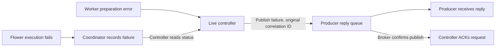

# Flower failure-flow board

Planning only, 2026-11-18. Read with [design.md](design.md) and
[decisions.md](decisions.md). This describes the proposed integration, not the
disabled runtime currently in the repository.

C40 confirms controller-startup reset, C42 permits only bounded transient status
read retries, C47 selects `Recreate` upgrades, and C48 confirms terminal coordinator
capacity errors. R14's coordinator orphan-cleanup/instance protocol remains the
recommended mechanism to implement and verify. Periodic file expiry is still R22.
C44 defers strict participant/complete-round enforcement.

## Ownership and the reply boundary

- **Controller:** owns the analysis request and its `correlation_id`/`reply_to`;
  validates/prepares, calls the coordinator, reads status, and publishes the final
  success or failure reply. The controller's router can also publish intake errors.
- **Native worker:** returns preparation errors over gRPC. It does not send the
  analysis reply. Aggregation cleanup belongs to the controller's phase context.
- **ServerApp/ClientApps and SuperLink:** execute the run. Client errors/timeouts
  reach the ServerApp through Flower. The ServerApp reports its result to the
  coordinator; the backend run state also has to confirm success.
- **Coordinator:** owns admission and in-memory execution records. It reports
  status to the controller and requests runtime stop/cleanup. It does not publish
  analysis replies to RabbitMQ and does not push a restart notification to the
  controller. A controller detects loss through failed reads or changed instance
  identity.
- **RabbitMQ:** stores queued messages and can redeliver unacknowledged deliveries
  when a consuming connection closes. It does not know the Flower run's status.
- **Producer/platform-backend:** owns the reply queue, correlates replies, and
  applies its own waiting timeout. A timeout is not proof that remote work stopped.



Broker confirmation establishes publication to the destination, not that the
producer has consumed the response. Failure notification and runtime termination
are separate: reporting an error must not release a still-live execution slot or
delete files still in use.

## Stage-by-stage board

| Stage / break | Who detects and notifies | Reply to the producer | Work and cleanup |
| --- | --- | --- | --- |
| Before request publication is confirmed | Producer sees failed/uncertain publish | No accepted-analysis reply can be promised | The request may or may not have reached the broker; follow the existing producer transport contract |
| Queued; controller is down | RabbitMQ retains the message; no running Flower attempt | No immediate failure; producer keeps waiting | After controller startup/reset succeeds, consume the queued request |
| Router cannot forward | Router gets mandatory return, nack, timeout, or connection failure | Live router sends a terminal availability failure when reply publication is possible | No forwarding retry. An uncertain handoff can already have reached an executor; connection loss can also cause redelivery |
| Validation/preparation fails, selected worker is missing, or native worker restarts during a gRPC call | Controller sees validation/gRPC/UDF error | Controller publishes a normal failed analysis reply, then ACKs after confirmation | Do not start Flower. Clean the phase's aggregation context; remove failed staging and expire prepared leftovers |
| Coordinator refuses start at capacity | Coordinator returns HTTP 429 / `flower_capacity_exceeded` | Controller propagates that failure and ACKs after confirmed reply | No new run, no retry or coordinator-side waiting queue; already prepared files need cleanup |
| Start HTTP/CLI call fails or its response is lost | Controller or coordinator sees the failed operation | Controller reports start/control availability failure without resubmission | A lost response does not prove no run started. Attempt bounded cleanup; keep pending/live/uncertain work counted until termination is established |
| Transient status HTTP failure while a run continues | Controller sees connection failure, timeout, or transient 502/503/504 | No failure yet: retry that read at most twice, within the execution deadline | Same context and expected instance. Never repeat start. If reads recover, continue observing the same run |
| Status retry budget/deadline is exhausted | Controller detects exhausted budget | Controller publishes a terminal unavailable/timeout reply | Request stop once when possible; the remote run may still be alive. Hold its capacity until stopped/deadline cleanup is established |
| Coordinator container restarts; SuperLink survives | Controller sees unavailable reads or, under R14, a changed coordinator instance | Controller publishes `flower_execution_lost` if restart is identified, otherwise unavailable after bounded read retries | New coordinator cancels surviving runs before accepting new work under R14. No adoption/resubmission of lost attempts |
| SuperLink restarts or loses a run while coordinator survives | Coordinator's backend check sees lost/unavailable run state; controller reads the failure | Controller publishes execution-lost/backend failure | Establish runtime/local-process cleanup before replacement admission; ServerApp/ClientApps may need deadline termination |
| ServerApp fails during training/evaluation | Flower records failure; coordinator's backend check observes it; controller reads status | Controller publishes the failed analysis reply | Stop remaining work and retain the live/uncertain capacity reservation until termination is established |
| ClientApp/sidecar/pod fails during training/evaluation | ServerApp receives an error or timeout through Flower | If Flower fails the run, controller sends failure; if the initial strategy continues, it returns metrics from actual successful evaluators | Strict failure-on-any-participant is deferred by C44. Never claim a guaranteed full-participant result; retain actual evaluator IDs/counts |
| Only native worker container restarts after preparation | Kubernetes marks the pod unready; Flower can still read its existing Arrow files | No automatic failure solely from readiness; the in-flight Flower run can still finish | C41 excludes the pod from new requests. Container restart preserves scratch; pod replacement also kills the sidecar and removes scratch |
| Result report from ServerApp to coordinator fails | ServerApp treats failed completion POST as an error; coordinator observes failed backend state or missing-completion deadline | Controller sends failure when it observes the terminal state | Completion POST is not retried under C42. A staged result alone cannot make a failed backend run successful |
| Controller crashes during preparation, running, or before publishing the reply | RabbitMQ sees the consuming connection close; replacement controller performs C40 reset | No immediate per-attempt failure reply. The replacement may later return a fresh attempt's result or failure | Cancel old owned runtime work before restarting the Flower consumer; broker redelivery uses a new context. Do not resume the old model |
| Controller crashes after confirmed reply publication but before ACK | Reply is already in the producer queue; original request is still unacknowledged | Producer may receive the original reply and a later duplicate reply | RabbitMQ can redeliver the original request; confirmation/ACK are not atomic, and exactly-once execution is not promised |
| RabbitMQ unavailable when sending the result/failure | Controller's reply publisher detects transport failure | No deliverable final reply until the existing AMQP transport can publish | Do not pretend the producer received an error. Keep the request unacknowledged; transport recovery/redelivery and bounded in-memory reply retention follow existing behavior |
| `reply_to` is absent, deleted, or rejects the reply | Controller's passive check or mandatory/confirmed publish fails | No reply can reach that destination; producer may time out | Reject the request without requeueing into the configured dead-letter path. No automatic replay; inspect logs/dead letters |
| Execution deadline expires or a live controller cancels | Controller/coordinator/runtime observes its deadline or cancel operation | Controller sends timeout/cancellation failure when reply transport is available | Stop once, clean aggregation/prepared state safely, and keep unresolved work counted. Failed stop is not retried or treated as proof of termination |

The same failure reporting applies to an entire coordinator-pod replacement, but
both coordinator records and SuperLink state may be lost. A coordinator-container
restart alone does not imply the separate SuperLink container stopped.

## Controller restart while an execution is running

```mermaid
sequenceDiagram
    participant P as Producer
    participant Q as RabbitMQ
    participant C as Old controller
    participant N as Replacement controller
    participant F as Coordinator / Flower
    C->>F: Start attempt A
    Note over C: Controller crashes; cannot publish a reply
    Q->>Q: Unacknowledged request becomes available for redelivery
    N->>F: Startup reset before starting Flower consumer
    F->>F: Close admission, stop old owned work, establish cleanup
    F-->>N: Reset completed
    N->>Q: Start Flower executor consumer
    Q->>N: Redeliver original request
    N->>F: Prepare and start fresh attempt B
    F-->>N: Attempt B result or terminal failure
    N->>Q: Publish reply with original correlation_id / reply_to
    Q-->>N: Confirm reply publication
    N->>Q: ACK original delivery
    Q-->>P: Deliver reply
```

This is the existing at-least-once request contract, not a newly introduced Flower
operation retry. There is no saved analysis record to send a guaranteed
"controller restarted" failure for the abandoned attempt. The coordinator cannot
replace the controller as the reply publisher because it has neither that
responsibility nor a durable request/reply record.

If startup reset fails, keep the Flower consumer stopped. The controller logs the
startup failure and Flower readiness/admission stays unavailable. Queued requests
wait and producers can reach their own timeouts; do not claim every queued request
received an error. Restoring the runtime/startup barrier is needed to proceed.

## Coordinator restart while the controller survives

```mermaid
sequenceDiagram
    participant C as Live controller
    participant F as Coordinator
    participant L as SuperLink
    participant Q as RabbitMQ
    C->>F: Start context X
    F-->>C: Accepted, instance A
    Note over F: Container restarts as instance B; records lost
    F->>L: R14 startup: cancel orphan work before admission
    C->>F: GET status for X, expecting instance A
    F-->>C: 409 coordinator_restarted, instance B
    C->>Q: Publish flower_execution_lost failure
    Q-->>C: Confirm publication
    C->>Q: ACK request
```

If the service is temporarily unreachable instead, use the bounded status-read
retries and report unavailable if they expire. The instance mismatch or an explicit
terminal error is not retried. Orphan cleanup proceeds independently of whether
the failure reply has already reached the producer.

## Validation gates

- Exercise controller loss at each message boundary, including the confirmed-reply
  / request-ACK race, and preserve the original producer correlation information.
- Restart coordinator and SuperLink containers separately. Verify lost-instance
  detection, startup cleanup, and the distinction between reporting failure and
  proving local calls stopped.
- Test capacity after an uncertain start or exhausted status read; no extra live
  run may bypass C48.
- Check worker failure during preparation versus native-container readiness loss
  after export. The latter does not imply automatic cancellation of a live run.
- Test a failed completion callback and unavailable/deleted reply destinations;
  never advertise successful delivery when publication failed.
- Verify each algorithm's chosen participant/failure policy and actual evaluator
  counts. C44 does not supply a strict policy implicitly.

References: [current AMQP consumer](../../exaflow/controller/services/rabbitmq/consumer.py),
[RabbitMQ acknowledgements and confirms](https://www.rabbitmq.com/docs/confirms),
and [Flower's current bagging aggregation](https://flower.ai/docs/framework/_modules/flwr/serverapp/strategy/fedxgb_bagging.html).
