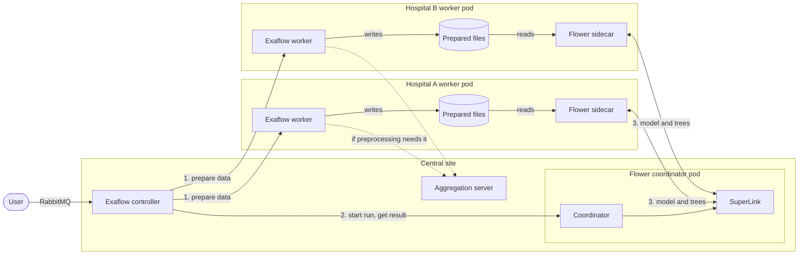
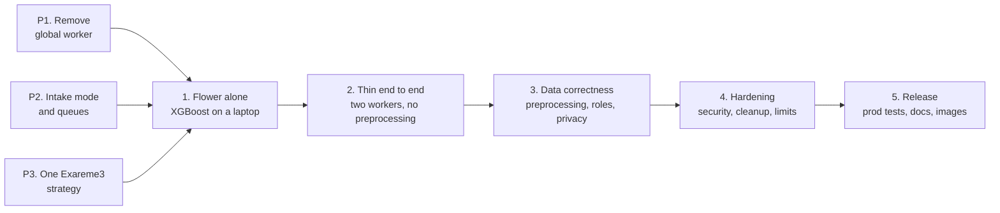

# Flower integration plan

Status: ready to start implementation, beginning with P1–P3. Last updated:
2026-11-18. Runtime changes have not been implemented or validated yet.

The initial scope and architecture decisions are settled in
[decisions.md](decisions.md). No further product decision is required before
starting. The implementer resolves technical details within those decisions,
records the concrete choices, and verifies them with focused tests. A material
scope/behavior change should be raised with the user; privacy approval remains
required before release.

The initial integration reuses existing preprocessing. Role-aware fit/transform
is excluded and has a [separate future PRD](prd/role-aware-preprocessing.md).
[future-work.md](future-work.md) separates deferred features from implementation
and release details that still need completing. Those deferred features do not
block the initial work.

The [design](design.md) describes the target behavior, and the
[failure-flow board](failure-board.md) explains notification, cleanup, and
controller-restart redelivery. Historical review alternatives in the design do
not override the current decisions or enlarge initial scope.

| File | Read it for |
| --- | --- |
| [plan.md](plan.md) (this file) | One-page overview, scope, and the order of work |
| [design.md](design.md) | How each part works, with diagrams |
| [decisions.md](decisions.md) | Confirmed choices and implementation recommendations |
| [failure-board.md](failure-board.md) | Failure stages, detection, notification, replies, and restart cleanup |
| [future-work.md](future-work.md) | Deferred enhancements and open initial-release details |
| [Role-aware preprocessing PRD](prd/role-aware-preprocessing.md) | Future fit/transform capabilities, responsibilities, and acceptance requirements |

## Overview

**Goal:** run federated XGBoost (binary classification) with Flower through the
normal Exaflow analysis flow, and return per-worker AUCs and pooled log loss.
The outcome has exactly two categories. No model is stored or returned to the user.

### How one analysis runs

1. A user starts an XGBoost analysis. The request arrives on the RabbitMQ intake
   queue, like any other analysis. A router forwards it to the Flower queue, which
   lets at most 1–2 Flower runs start at a time.
1. The controller asks every worker that holds a requested dataset to prepare its
   data. Each worker loads, filters, and preprocesses the rows, runs the privacy
   checks, and writes the result as files in a private folder inside its own pod.
1. The controller asks the Flower coordinator to start a training run.
1. Flower's server (SuperLink) sends the current model to the Flower sidecar at
   each training hospital. Each sidecar reads its local files, trains, and sends
   back new trees. This repeats for a fixed number of rounds.
1. The hospitals holding validation data score the final model.
1. The coordinator passes per-worker AUCs and pooled log loss to the controller,
   which replies to the user. The sidecars delete the prepared files.

### What is new, what changes, what stays

| | Items |
| --- | --- |
| **New** | `exaflow-flower/` project and image; Flower coordinator pod (coordinator and SuperLink); Flower sidecar and scratch volume in each worker pod; one data-preparation UDF |
| **Changes** | New `FlowerStrategy` in the controller; Helm chart; Flower specifications loaded from copied JSON; XGBoost result fields; the old Flower code is deleted |
| **Changes first ([prerequisites](#prerequisites))** | No global worker; one intake mode per deployment; router and two executor queues; limits from queue prefetch instead of semaphores; one `Exareme3Strategy` |
| **Stays** | Native algorithms and their results; existing preprocessing behavior for native callers; privacy thresholds; worker data-execution gRPC operations; aggregation server; the message format platform-backend publishes. P1's worker-role metadata/protobuf removal is documented separately |

## Scope

In scope:

- Binary XGBoost as the first and only Flower algorithm.
- Exactly two outcome categories, with an explicit positive class. Return
  per-worker AUCs and log loss pooled by evaluation row count.
- Separate whole datasets for training and validation. Validation may span multiple
  workers, including workers that also train.
- Exaflow and Flower images released together as one product version.
- Reuse current Exaflow preprocessing before role-specific privacy checks and
  Arrow export. No new fit/transform planner or fitted-state transport initially.
- Private SuperLink access with NetworkPolicies/TLS, trusting permitted workloads
  and operators. Exaflow submissions use the coordinator's local CLI; there is no
  extra reverse proxy or enforced coordinator-only Control API access (C29/C39).

Out of scope:

- Role-aware fitted preprocessing and training-only fit/state replay (C49/C50),
  tracked in its [future PRD](prd/role-aware-preprocessing.md).
- Storing models, inference, or a public job API.
- Saving execution state or recovering runs after a restart
  ([background](design.md#appendix-what-restart-recovery-would-need)).
- Compatibility between different Exaflow and Flower versions.
- Random row splits between training and validation.

## Prerequisites

Three changes land **before** Flower work starts. They touch existing native code,
so each is its own PR. They can be developed in parallel. Their intermediate
contract is explicit: known Flower requests return `FlowerUnavailableError` until
the replacement is enabled. None of the prerequisites may invoke the retired
global-worker-dependent Flower strategy; native execution remains available.

| Step | Change | Why Flower needs it | Details |
| --- | --- | --- | --- |
| P1 | Remove the global-worker role | Validation data goes to whichever worker holds the requested validation datasets; no special role | [Checklist](design.md#prerequisite-global-worker-removal) |
| P2 | One intake mode per deployment (`rabbitmq` or `http`), a router, and separate `exareme3` and `flower` queues; queue prefetch replaces the semaphores | Separate native and Flower admission limits; queued Flower requests do not occupy native delivery slots | [Intake and queues](design.md#prerequisite-analysis-intake-and-queues) |
| P3 | Merge the two Exareme3 strategies into one, with a shared `aggregation_context` helper | `FlowerStrategy` reuses the same helper for preprocessing | [One Exareme3 strategy](design.md#prerequisite-one-exareme3-strategy) |

## Order of work

Each step ends with something that runs.

0. **Prerequisites P1–P3.** See [Prerequisites](#prerequisites).
1. **Flower alone.** Write the XGBoost ServerApp and ClientApp so they read Arrow
   files from a folder. Run them with Flower's simulation mode, or a local SuperLink
   and two SuperNodes. No Exaflow and no Kubernetes yet.
1. **Thin end to end.** Delete the old Flower code. Add the data-preparation UDF
   without preprocessing, the coordinator (start, status, cancel, result), and the
   Helm resources. On kind with two workers, an analysis returns an AUC.
1. **Data correctness.** Reuse the existing preprocessing path, including its
   aggregation-backed steps and generated-column metadata. Split/export training
   and validation roles afterwards, apply privacy checks, and encode categories
   consistently. Fail if any requested worker/role is insufficient. Native
   behavior stays unchanged; do not add fit/transform hooks or state replay in
   this integration.
1. **Hardening.** Add cancellation, deadlines, cleanup of abandoned files, TLS and
   SuperNode authentication, NetworkPolicies, and failure tests. C40 requires the
   controller to reset owned Flower work before starting its Flower consumer;
   do not purge queued requests or resume partial models. Use whole-pod exclusion
   under C41 when either worker container is unready/unhealthy. Revised C42 permits
   bounded retries only for transient HTTP status reads; propagate other failures
   and exhausted status-read failures without resubmitting an analysis. Add C48's
   coordinator admission check and C47's `Recreate` rollout settings.
1. **Release.** Run the XGBoost prod-environment validation, update the API,
   algorithm, and deployment docs, and publish the images.

## Acceptance checks

- Native algorithms keep their results and preprocessing behavior.
- Current native preprocessing is reused, including generated feature schemas and
  aggregation where needed. Verify selected supported steps through the export
  path; the future fit/transform PRD is not an initial acceptance gate.
- Exported training and validation inputs stay role-separated, also when one
  worker holds both. Existing preprocessing runs before that split. Privacy checks
  apply independently to the rows actually exported for each assigned role.
- Every assigned worker/role meets the existing privacy minimum independently.
  Insufficient training or validation input fails the whole requested analysis;
  users can explicitly rerun with a different dataset selection.
- Prepared inputs match current native preprocessing for the same selected input
  rows and parameters. Do not claim training-only fitting while the initial path
  still preprocesses training and validation together.
- Single-worker XGBoost matches a deterministic reference. Multi-worker bagging is
  compared with Flower's own method, not with pooled data.
- Concurrent runs, duplicate submissions, failures, timeouts, restarts, and
  cancellation never mix inputs or return stale results. Enhanced strict
  participant/failure enforcement follows the initial integration under C44.
- Only transient HTTP execution-status reads may retry within a bounded budget
  and the execution deadline. Exhausted status reads, failed start/cancel/reset/CLI
  operations, failed forwarding, run failures, and detected execution loss produce
  terminal errors without analysis resubmission or recovery.
- An outcome with more or fewer than two declared categories is rejected. Every
  worker uses the same positive-class mapping. Results contain per-worker AUCs and
  row-weighted pooled log loss, with no combined AUC field.
- Controller and worker images do not install Flower or XGBoost. The controller
  reads Flower specifications without importing the Flower project.
- The coordinator accepts only enabled IDs from its installed app catalog and
  rejects external bundles, paths, URLs, or entrypoint overrides. This does not
  claim that Flower itself prevents direct submission of another app bundle.
- If either worker container is unready/unhealthy, exclude that pod from analyses.
  Re-admit it after readiness recovers; use normal ready-only discovery.
- Only allowed pods reach SuperLink, with no extra proxy. Application submissions
  use the coordinator; allowed worker pods are trusted with the shared listener.
  SuperNodes retain TLS and node authentication under the existing C29 choice.
- Helm renders with Flower enabled and disabled.
- Queued Flower requests do not consume native executor slots. Verify shared-router
  overflow behavior and restart admission before claiming latency isolation or a
  hard `flower.max_concurrent_runs` bound through failures.
- In `rabbitmq` mode, `POST /analysis` is refused and the specification and
  metadata endpoints still work.
- Controller AMQP setup declares the analysis/dead-letter queues before consumers
  start; producers provision their reply queues before submitting requests. See
  [queue ownership](design.md#queue-creation-and-ownership).
- During the prerequisite transition, known Flower requests receive a terminal
  unavailable error, and native analyses continue without the old Flower strategy.
- After controller restart, the Flower consumer starts only after the idempotent
  reset has stopped/cleaned old owned runs. AMQP redelivery then starts fresh attempts.
- Normal controller/coordinator upgrades use `Recreate`; excess coordinator starts
  return `flower_capacity_exceeded` without retry. Verify the notification and
  settlement paths on the [failure-flow board](failure-board.md).

The [follow-up register](future-work.md) lists deferred features and the remaining
initial implementation/release decisions, with owners. The
[decision log](decisions.md) remains the source of confirmed choices. In
particular, C49/C50's future PRD, C44's enhanced participation policy, and C41's
possible independent-eligibility enhancement do not enlarge the initial scope.

## Risks and rollback

- **Model privacy.** XGBoost trees contain values derived from patient data, and
  every hospital receives the combined model. See
  [XGBoost and privacy](design.md#xgboost-and-privacy). This needs a privacy
  sign-off before release.
- **Initial preprocessing limitation.** Current preprocessing can learn from
  validation rows together with training rows. The initial integration retains
  that behavior; its documentation must not promise training-only fitted holdout
  evaluation. The separate future PRD addresses this limitation.
- **Shared pods.** The sidecar shares CPU, memory, and disk with the worker.
  Resource limits and the readiness rule in
  [Inside a worker pod](design.md#inside-a-worker-pod) contain this.
- **Rollback.** Set `flower.enabled=false` in Helm. Native analyses keep working.
  Old Flower clients are not supported.
