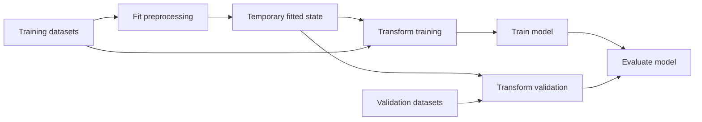

# PRD: role-aware fitted preprocessing

Status: future work, explicitly excluded from the initial Flower integration.
Date: 2026-11-18. Related decisions: C49/C50. This is a framework extension to
Exaflow, not a requirement for completing P1–P3 or the initial Flower release.
See the [initial plan](../plan.md) and [future-work register](../future-work.md).

## Problem

The current native preprocessing path can learn statistics from the combined
training and validation input. Running it separately on both roles can also learn
different transformations. Neither provides training-only fitted preprocessing
with a consistent transformation for independent evaluation.

The future framework must offer the necessary operations and role controls.
Algorithm developers choose and document their preprocessing workflow. The
platform must not hardcode one PCA, K-means, or XGBoost pipeline.

## Goal and evaluation semantics

For an independent evaluation workflow:

1. Fit learned preprocessing using training datasets only.
1. Transform training datasets with that fitted state.
1. Transform validation datasets with the same appropriate fitted state.
1. Train the model on transformed training inputs and evaluate it on transformed
   validation inputs.

Transformation applies to **both** roles. Fitting is not repeated on validation
rows. Fixed transformations need no fitting phase. The algorithm developer
declares the fitting population, operations, scope, and generated features; the
framework enforces that declaration and the existing privacy boundaries.

## Roles and responsibilities

| Role | Responsibility |
| --- | --- |
| Algorithm developer | Declare the pipeline, input roles, fitting population, local/federated scope, supported steps, feature/output schema, and evaluation semantics |
| Preprocessing-step author | Implement fixed transformation or explicit fit/transform hooks; define fitted-state fields, required inputs, and metadata changes |
| Exaflow controller | Validate the declared plan, select participants per phase, orchestrate dependencies, distribute fitted state, and own aggregation/cancellation cleanup |
| Exaflow worker | Load local role-specific rows, enforce privacy checks, execute hooks, retain raw rows locally, and export final model inputs |
| Flower runtime | Consume prepared Arrow inputs and execute training/evaluation; do not fit native preprocessing implicitly or duplicate privacy checks |
| End user | Select datasets and algorithm parameters through the algorithm's declared interface; no responsibility for coordinating fit/transform calls |

## Functional requirements

| ID | Requirement |
| --- | --- |
| FR01 | Keep training/validation roles explicit from selection through fitting, transformation, and export. Reject overlapping dataset assignments |
| FR02 | Allow an algorithm to declare training-only fitting. Validation-only workers must not contribute rows/statistics to that fit |
| FR03 | Apply the resulting transformation to both training and validation inputs without learning new parameters during transform |
| FR04 | Support fixed transformations, worker-local fitting, and federated fitting using the existing aggregation infrastructure |
| FR05 | Carry typed fitted numerical state between phases. State includes feature order and the mapping needed to apply it consistently; raw input rows remain local |
| FR06 | Make the mapping from fitted state to validation workers explicit. If local fitting is selected, a validation-only worker must have a declared applicable state; never silently refit on validation rows |
| FR07 | Execute pipeline steps in order: fit each learned step on the current training representation, then transform both roles before the next step |
| FR08 | Preserve ordered feature names/types, categorical codes, generated columns, target mapping, and required source-column lineage |
| FR09 | Enforce existing minimum-row checks per selected worker/role before and after relevant preparation and before export. Do not combine role counts, lower thresholds, or introduce per-class thresholds implicitly |
| FR10 | Give fitted state and aggregation phases execution-scoped identity, bounded lifetime, and cleanup ownership. Reject state from another attempt or incompatible feature schema |
| FR11 | Expose supported preparation capabilities and statistical policy through the algorithm's specification/documentation; validate unsupported combinations explicitly |
| FR12 | Keep orchestration in Exaflow. Reuse the existing worker transport and registry rather than importing Exaflow into the independent Flower project |
| FR13 | Preserve existing native preprocessing behavior unless an algorithm explicitly adopts the new contract. Do not globally change every registered step or add legacy aliases/fallbacks |

Fitted state is temporary preparation state, separate from the initial release's
decision not to save or expose trained prediction models. Its lifetime ends with
the analysis; durable reuse would require a separate storage contract.

## PCA and K-means requirements

| Step | Fitting state | Transformation behavior |
| --- | --- | --- |
| PCA | Training-derived feature means, components, component order, and any scaling/whitening quantities | Project training and validation with the same state; do not learn a separate validation basis |
| K-means | Training-derived centers, feature order/scaling, and stable cluster IDs | Assign training and validation rows to those centers; validation rows must not update centers |

The current K-means column creator can replay supplied centers. The current PCA
column creator refits even when supplied its reusable recipe; that recipe is not
yet a complete numerical fit-state replay contract. Audit and extend each step
when implementing this PRD, rather than assuming matching method names establish
the required semantics.

## Acceptance requirements

- Changing validation rows leaves the training-fitted state unchanged.
- Transformation uses the same fitted state on both roles; it does not call fit.
- PCA outputs match a training-fit reference projection for both roles, including
  feature order and scaling.
- K-means uses identical centers and category IDs at training and validation
  workers, including a validation-only worker.
- A worker holding both roles behaves like the same role-separated inputs on
  separate workers under the declared common fitting policy.
- Validate a mixed fixed/learned pipeline, generated features, missing values,
  unsupported schemas, and empty/insufficient selected roles.
- Privacy checks and error propagation remain effective for every phase.
- Failed/cancelled phases clean up aggregation and temporary fitted state without
  affecting another analysis or deleting state still in use.
- Existing native algorithm results remain unchanged unless that algorithm opts
  into the new contract.

## Implementation decisions for the future work

These are assigned to framework/algorithm developers, not blocking questions for
the initial Flower integration:

- Hook signatures and the specification fields that describe a preparation plan.
- Fitted-state representation, transport limits, and local storage/lifetime.
- The supported first set of preprocessing steps/variants and their migration order.
- How worker-local fitted state is selected for validation on a different worker.
- Rules for supervised preprocessing and source-column dependencies that prevent
  an algorithm from inadvertently using validation outcomes to construct features.
- How an algorithm documents a deliberately different evaluation protocol. A
  workflow fitted on validation data must not be described as independent holdout
  evaluation.

## Dependencies, non-goals, and rollout

Implement after the initial Flower integration and its data-export contract are
working. Deliver this as a separate change/PRD with focused native preprocessing
and federated-reference tests. Let algorithms adopt declared capabilities
incrementally; do not require a platform-wide migration in the first change.

Automatic row splitting, cross-validation, saved preprocessing artifacts across
restarts, trained-model storage/inference, and a redesign of the Flower runtime
are separate work. The initial Flower release continues the existing preprocessing
behavior and documents its evaluation limitation.

Reference: [training-only fitting and consistent transformation](https://scikit-learn.org/stable/common_pitfalls.html#data-leakage).
